# 迭代小组平台 · 使用说明书

**版本 1.1.0**
**日期：2026-11-20**

这本说明书写给每天使用平台的同事：不用懂技术，照着章节做就能完成从注册登录到迭代复盘的全部日常操作。安装、备份、迁移等管理员操作在第六章概述，详细步骤以随包的《部署手册》为准。

文中出现的小组、姓名与事项均为演示示例，截图也全部来自演示数据，不含任何真实单位与业务信息。

> 本说明书有离线网页版：登录平台后点侧栏「帮助」即可打开（地址 `/help/index.html`），内容与本说明书一致，随安装包发布，内网无外网也能看。

---

<!-- doc-toc-start -->

## 目录

- 第一章 五分钟上手
- 第二章 基本概念
- 第三章 按角色操作指南（成员 / PO / 组长 / 平台管理员 / 报告）
- 第四章 常见场景问题
- 第五章 AI 功能说明
- 第六章 管理员与运维篇
- 附录 A 快捷键 / 附录 B 权限总表（简化版）/ 附录 C 状态流转表 / 附录 D 名词解释 / 附录 E 版本记录

<!-- doc-toc-end -->

## 第一章 五分钟上手

你要做的是：打开平台、注册登录、加入小组、在工作台看到自己的事项、登记一次进展。五步做完，你就会用平台了。

**第 1 步：打开网址**

向组长或平台管理员要平台地址，一般长这样：`http://<服务器IP>:18080/`。在 Chrome 或 Edge 里打开，看到登录页就对了。

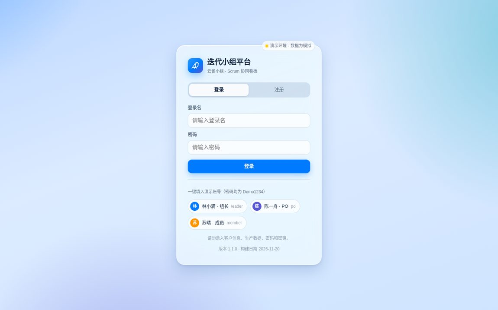

**第 2 步：注册并登录**

第一次用点「注册」：填登录名（注册后不可修改）、显示名和密码（至少 8 位，同时含字母和数字）。之后每次用登录名 + 密码登录即可。连续输错密码会被短暂锁定，稍等再试。

注意：平台管理员不是注册出来的。安装平台时系统会生成内置管理员账号 `admin`，初始密码在安装窗口和服务器上的 `config\admin-initial-password.txt` 里，首次登录必须改密码。普通同事正常注册就行，不需要关心这件事。

**第 3 步：加入小组**

登录后如果还没有小组，会直接进入「加入或创建小组」页：

- 已有小组的：把组长给你的 8 位邀请码填进「加入小组」，点「预览小组」确认是自己的组，再提交加入申请；组里开了审批的，要等组长在「小组设置 → 加入申请」里通过，你会收到通知。
- 自己建组的：填小组名称、代号（2–5 个字母，是事项编号的前缀，如 SKY）、主题色和迭代周期，点「创建小组」；创建人自动成为组长，并得到邀请码去邀请别人。

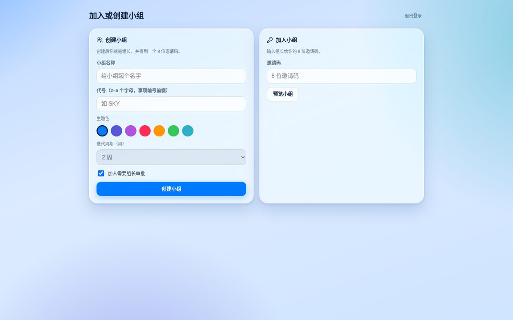

**第 4 步：在工作台看到自己的事项**

进入小组后，首页就是工作台。它按「进行中 / 待开始 / 待我验收 / 我发出的」分组列出和你有关的事项，右侧有近期关键日期和「邀请我认领」。每天上班先看这里。

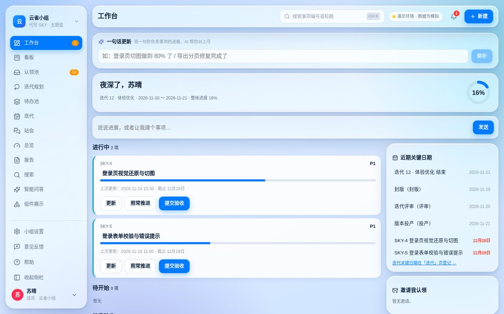

**第 5 步：登记一次进展**

在工作台点开任意一个你负责的事项，在进展框里写一句话（如「联调完成，还差异常提示」），拖动进度条，点「提交」。这就是一次完整的进展登记。没什么变化时，点「照常推进」即可。

到这里你已经上手了。下面的章节按「先懂概念、再按角色学操作、遇到问题查场景」的顺序写，随用随查。

---

## 第二章 基本概念

你要做的是：先把几个名词弄明白，后面所有操作都是这些名词的组合。

### 2.1 事项的种类

平台里一切工作都是「事项」，分五类：

| 类型 | 是什么 | 例子 |
| --- | --- | --- |
| 任务 | 一件较大的事，由 PO 负责，下面挂若干故事 | 「登录页改版」 |
| 故事 | 任务拆出的可独立交付的小块，有故事点估算，分开发/测试/分析/其他类别 | 「登录页视觉还原与切图」 |
| 缺陷 | 发现的问题、故障 | 「图片上传旋转方向不对」 |
| 分析 | 调研、方案类工作 | 「编辑器协同冲突方案分析」 |
| 临时事项 | 临时交办、不进迭代的杂事 | 「阅读并确认新版代码评审规范」 |

缺陷、分析、临时事项合称「独立事项」：不属于某个任务，可以直接建、直接派。事项都有编号（如 `SKY-14`），编号 = 小组代号 + 序号，全平台沟通时报编号最不容易出错。

### 2.2 状态与流转

每个事项都处在一个状态里，只能按下面的方向走：

| 当前状态 | 可以去 | 谁来推动 |
| --- | --- | --- |
| 待认领 | 待开始（被认领后） | 任何成员在认领池认领，或组长/PO 指派 |
| 待开始 | 进行中 | 负责人开工时登记一次进展即可 |
| 进行中 | 待验收 | 负责人点「提交验收」 |
| 待验收 | 已完成 | 验收人点「通过」 |
| 待验收 | 进行中（打回） | 验收人点「打回」并写原因，负责人修改后重新提交 |
| 任意 | 已取消 | 创建人或组长取消（看板上可勾选「显示已取消」查看） |

「阻塞」不是状态，是一个标记：事项还在进行中，但被卡住了，必须写明原因（如「等设计稿确认」）。看板、站会、总览都会突出显示阻塞事项。

### 2.3 几个池子和页面

| 名词 | 在哪 | 干什么用 |
| --- | --- | --- |
| 工作台 | 侧栏「工作台」 | 我的事项总入口：进行中、待开始、待我验收、我发出的 |
| 看板 | 侧栏「看板」 | 当前迭代（或日常）的事项按状态分列，可按任务/按人/按类型分泳道，可只看我的、只看阻塞 |
| 认领池 | 侧栏「认领池」 | 还没人负责的事项，成员自助认领；侧栏角标是待认领数量 |
| 待办池 | 侧栏「待办池」 | 任务列表，由 PO 维护：任务和它下面的故事、进度都在这里 |
| 迭代规划 | 侧栏「迭代规划」 | 把故事放入/移出某个迭代，看每人容量 |
| 迭代 | 侧栏「迭代」 | 迭代列表与详情：燃尽图、关键日期、迭代外工作、结束迭代 |
| 站会 | 侧栏「站会」 | 按人汇总昨日进展、今日计划和阻塞，开站会时投屏用 |
| 总览 | 侧栏「总览」 | 迭代健康度（剩余估算 vs 理想线、阻塞数、长期未更新、完成率）和成员负载 |
| 报告 | 侧栏「报告」 | 周报/迭代报告：生成、编辑、导出 |
| 回收站 | 小组设置里 | 删掉的事项先进这里，可恢复或彻底删除 |

### 2.4 迭代与故事点

- **迭代**：一段时间（如两周）的一个工作周期，有名称、目标和起止日期。故事被放进迭代，才算排上了期。尚未开始的迭代里的事项不参与「未更新、逾期」类提醒和风险统计，迭代开始后才计时。
- **故事点**：对工作量的相对估算（1 点最小，点数越大越费劲），不是工时。迭代规划时看容量：**个人剩余容量 = 剩余可用工作日 × 容量系数**（系数在小组设置里调，默认 1）；请假、出差的日子不计入；共同负责的故事点按人数均分。超容量只提示、不拦截，认领池认领时也会给出同样的提示。

### 2.5 认领、指派、共同负责

- **认领**：事项在认领池里，谁点「认领」谁负责；也可以被组长/PO 邀请认领，邀请出现在工作台右侧，接受或婉拒都可以，婉拒要写原因。
- **指派**：组长、PO 或创建人直接把事项给到某人，对方收到「指派给我」通知。这类通知在个人设置里关不掉，保证工作不漏接。
- **共同负责**：一个事项可以有负责人 + 若干协作人（共同负责）。共同负责的人同样能更新进展；验收时，负责人和协作人都不能验收自己参与的事项（见 2.7）。

### 2.6 催一下与阻塞回应

事项停滞时，任何关注它的人都能点「催一下」。被催的人会收到通知，打开事项会看到「已被催办 N 次」的横幅，三个回应按钮：

- **马上更新**：马上去写进展；
- **今天搞定**：承诺今天完成；
- **卡住了**：必须写一句话原因，这句话会成为该事项的阻塞原因，组长在站会和总览里能看到。

请假中的成员被催时，催办会改催组长，不打扰请假人。

### 2.7 验收

故事和任务都要验收才算完成。规则是：

- 故事默认由 PO 验收，任务默认由组长验收；在「小组设置」里可以分别修改「故事默认验收角色」和「任务默认验收角色」。
- 组长和 PO 都可以担任验收人；**谁都不能验收自己负责（含共同负责）的事项**，这种情况下系统自动把验收人交给另一角色，不用人工改。
- 一个任务下面的故事全部完成后，任务自动进入待验收并通知任务验收人。
- 验收打回必须写原因；任务被打回时，按打回说明重开相关故事或补新故事再推进。

### 2.8 通知与角标

通知有三层，缺一不可地了解：

1. **站内通知**：右上角铃铛，汇总指派、催办、@、验收、系统消息等，未读数标红。
2. **浏览器提醒（人人可用）**：有未读通知时，浏览器标签页标题会带上未读数，网站图标上会出现红点角标——不用打开页面，瞥一眼标签页就知道有没有新事。这层不受任何开关影响。
3. **桌面通知（可选）**：在「个人设置 → 浏览器提醒」里打开后，指派给我、邀请我认领、@ 我、催我、待我验收这五类会弹出系统桌面通知，点击直达事项。限制要记牢：
   - 只有通过**安全来源**访问才能用：即单位给平台配了 HTTPS，或者你在服务器本机用 localhost 打开。用 `http://局域网IP:端口` 访问时，开关会是灰的，这是浏览器的安全规定，不是平台坏了；标题未读数和图标角标不受影响。
   - 只有平台网页**处于打开状态**（含切到后台的标签页）时才收得到；把浏览器关掉就收不到。所以建议把平台标签页**固定**在浏览器上。
   - 平台标签页正在最前面时不弹（你已经在看了）；同一事项 30 秒内只弹一条，不会刷屏。
   - 另有「提示音」开关（默认关），有新通知时响一声短音。

通知太多时，在个人设置里打开**精简通知**：只保留六类——指派给我、邀请我认领、@ 我、催我、待我验收、加入申请；并且同一事项 5 分钟内的多条变化会合并成一条。指派类和催办类通知永远关不掉，这是故意的设计。

### 2.9 谁在什么时候做什么

| 阶段 | PO | 组长 | 成员 | 平台管理员 |
| --- | --- | --- | --- | --- |
| 迭代开始前 | 建任务、拆故事、排待办池优先级 | 建迭代、定目标与关键日期 | 看认领池，提前认领规划中的故事 | 保证服务在运行、备份正常 |
| 迭代进行中（每天） | 跟进任务进度、答疑 | 开站会、看总览风险、处理阻塞 | 看工作台、更新进展、标阻塞、回应催办 | 处理意见反馈（平台级） |
| 有事项完成时 | 验收故事 | 验收任务 | 提交验收、按打回意见修改 | — |
| 迭代结束时 | 参与复盘 | 结束迭代（决定未完成事项去向）、看迭代总结 | 补齐进展记录 | — |
| 周期性 | 生成报告并向上汇报 | 审阅报告 | — | 看系统信息与备份状态、处理反馈与账号 |

---

## 第三章 按角色操作指南

你要做的是：找到自己的角色，只学自己那一章就够日常用了；其他角色的章节当字典查。

### 3.1 成员：每天怎么用

**早上：看工作台**

打开工作台，先看「进行中」和右侧「近期关键日期」：哪件今天到期、哪件被催了，心里有数。工作台顶部的输入框可以随手写一句进展发送，也可以先点开事项再细写。

**认领新活：认领池**

侧栏「认领池」的角标是待认领数量。列表可按最新发布、截止最近、等待最久排序，也可按类型筛选。每条显示发布人、故事点、截止日期、已等待天数。点「认领」即成为负责人；认领前会看到自己的容量提示（超容量只是提醒，不拦截）。被邀请认领的事项在工作台右侧「邀请我认领」，可以接受，也可以婉拒（写一句原因）。

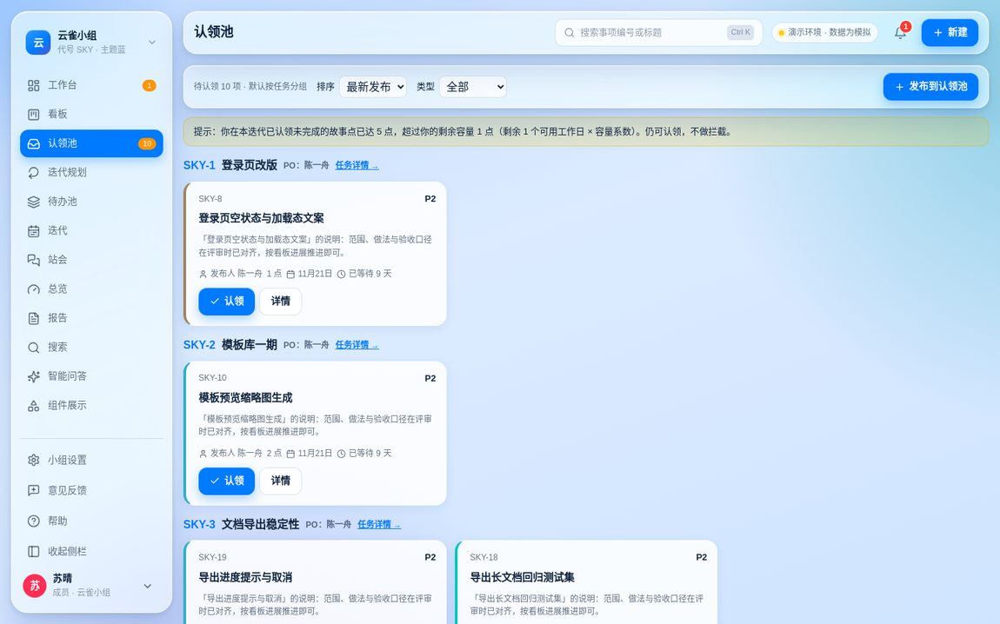

**推进：登记进展**

点开事项（右侧滑出详情抽屉），在进展框写一句话、拖动进度百分比、点「提交」。输入 `@` 可以提及同事，被 @ 的人会收到通知。进展不限次数，每天至少更新一次自己进行中的事项；确实没变化就点「照常推进」。

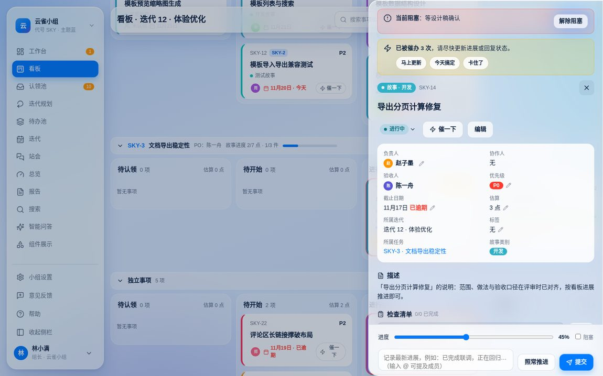

**卡住了：标阻塞**

在事项里勾「阻塞」并写明原因（如「等设计稿确认」「依赖的接口还没联调完」）。阻塞会同步出现在看板、站会和总览里，组长会来协调。问题解决后点「解除阻塞」。

**被催了：回应催办**

打开事项，横幅上有「马上更新 / 今天搞定 / 卡住了」三个按钮，点一个并按要求补充说明。不要无视催办——催办次数会显示在卡片上。

**做完了：提交验收**

进度拖到 100% 时不会自动提交，进度条下方会就地问一句「进度已到 100%，要提交验收吗？」，点「提交验收」事项才进入待验收，验收人会收到通知；点「暂不」后卡片上会留一个「可提交验收」小标记，不会反复弹。被打回（退回）时进度保持不变，卡片会显示「已退回」标记和退回意见，改好后再次提交。提交验收或完成时，事项上挂着的阻塞标记会被自动清除（历史里留痕）。

几个自动联动，知道就行：待开始的事项把进度从 0 拖到大于 0，会自动变为进行中（顶部提示条 5 秒内可撤销）；状态变为待验收或已完成时，进度低于 100% 的会自动补满并变只读；放回待认领或婉拒时会先确认，确认后进度清零（记录保留在历史里）；已取消的事项不显示进度条。任务的进度不用手填，由它下面的故事按故事点自动算；故事全部完成后，任务负责人会看到「故事已全部完成，要验收任务吗？」的提示。已完成的事项只能再改描述，想改其他内容要先「重新打开」（会留痕）。

**请假：先设置状态**

在「个人设置 → 我的成员状态」里选请假（或出差、外借），填起止日期保存。保存时会列出请假期间到期的事项，提示你先转交；请假开始前一个工作日，系统会提醒你和组长。请假期间：你的容量按 0 算，催办改催组长，站会卡片会标明请假。

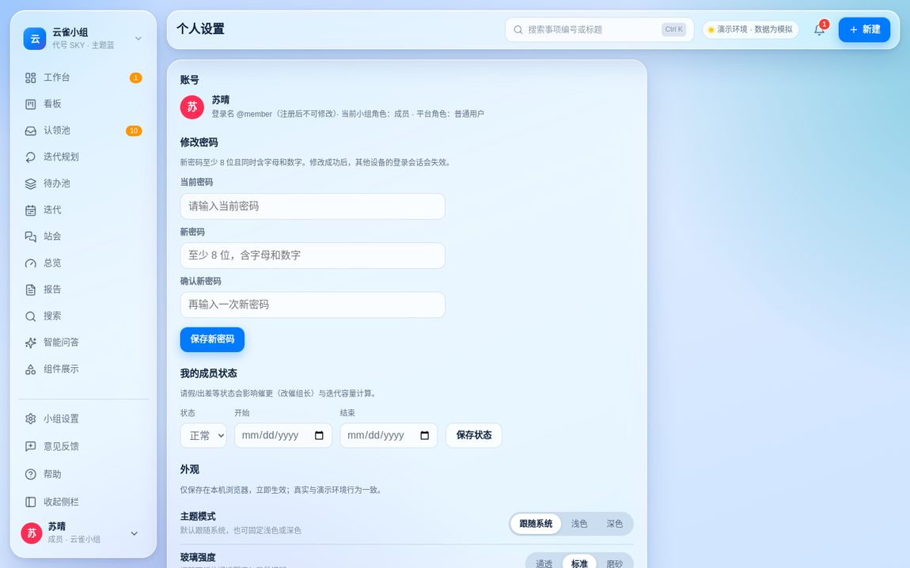

**个人设置里还能改什么**

改密码（改后其他设备要重新登录）、通知偏好（见 2.8）、精简通知、桌面通知与提示音、外观主题。

**外观（个人设置 → 外观）**：可选择浅色、深色（暮光蓝灰）、石墨或跟随系统四种主题。跟随系统时，系统切换深/浅色，平台会自动跟着切换（系统深色对应暮光蓝灰）。主题选择保存在你的账号里，换一台设备登录也会是同一个主题；还没登录时，登录页按你这台设备的系统外观显示。深色下浏览器标签页图标会自动换成深色版。

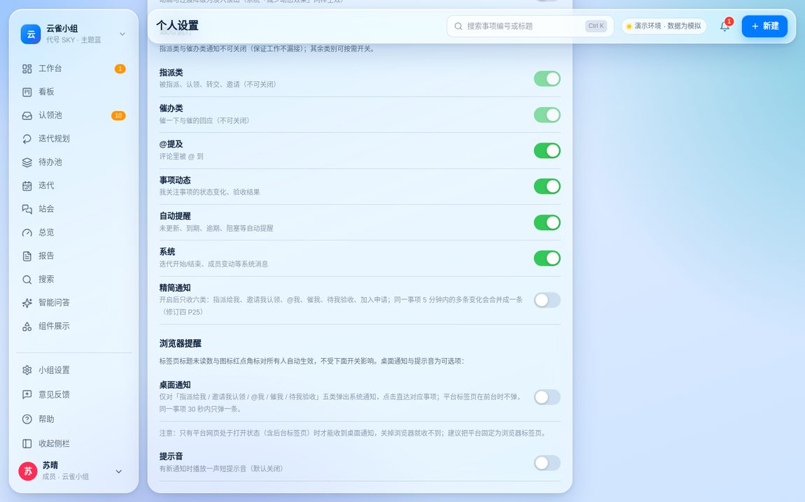

### 3.2 PO：把需求管起来

**建任务**

在「待办池」点「新建」建任务：标题、背景与目标、验收口径写清楚。待办池按任务列出每个任务的故事数和完成百分比，这是你排优先级的主视图。

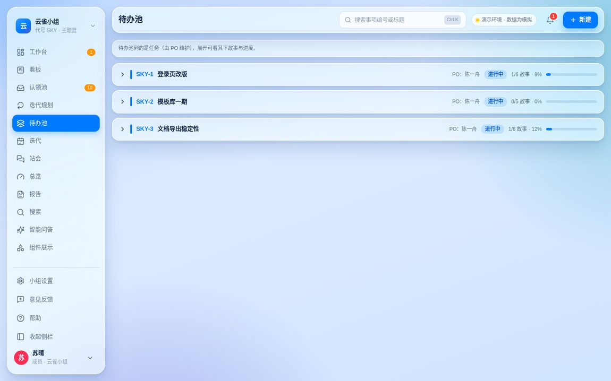

**拆故事**

打开任务，在其下逐个建故事：每个故事要能独立交付，估算故事点，选类别（开发/测试/分析/其他）。大故事可以用 AI 拆故事（见第五章），草稿确认后才创建。组长同样可以拆故事，你们可以分工。

**导入存量需求**

已有的需求清单、会议纪要用「粘贴导入」：粘贴文本（或上传 Excel/CSV），AI 拆成事项草稿，逐条勾选、修改后批量建单（见第五章）。

**排待办池与发布认领**

评审过的故事可以「发布到认领池」让成员自助认领，也可以直接指派。长期无人认领的事项会在认领池沉底，评审时决定保留、拆小或移入回收站。

**验收**

工作台「待我验收」集中处理：逐个看完成情况，点「通过」或「打回」（打回必填原因）。故事默认归你验收、任务默认归组长验收；你自己负责的故事会自动转给组长验收，不用操心（见 2.7）。

### 3.3 组长：把迭代跑起来

**建小组和管理成员**

「小组设置」是你的管理台，左侧页签包括：成员与角色、基本设置、容量与提醒、标签、AI、对接、加入申请、邀请码、审计日志、归档与退出、回收站。

- 成员与角色：改角色（组长/PO/成员）、设成员状态、移除成员。
- 加入申请：审批新成员加入。
- 邀请码：查看和重置本组 8 位邀请码。
- 基本设置：迭代周期、故事/任务默认验收角色等。
- 审计日志：本组关键操作记录，只读，出问题先来这里查。

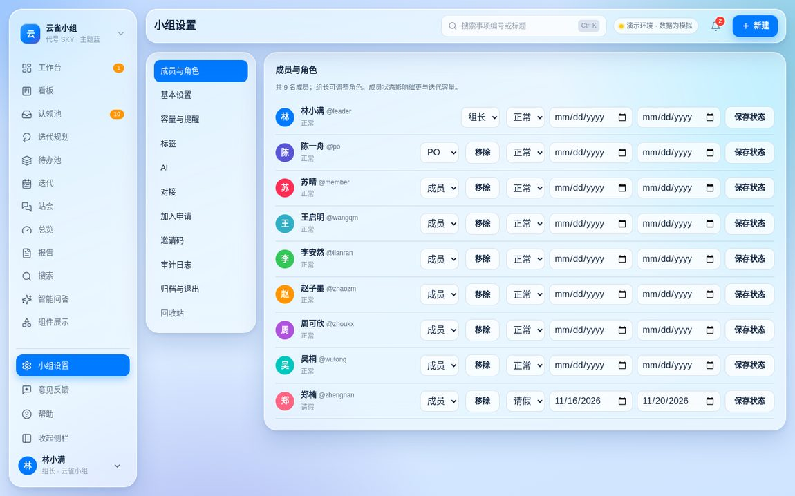

**成员离组：必须先交接**

移除成员、成员主动退出、或账号被停用前，系统会拦住并列出此人未处理完的全部条目：他负责的未完成事项、待他验收的事项、他发出的「每人一份」批次。你可以逐条转交他人，或一键全部退回认领池（其中待验收事项退回后改由组长验收）；共同负责的事项会自动去掉此人，不用处理。全部处理完，才能完成移除。停用账号时，对此人所在的每个小组都要走一遍这个流程。

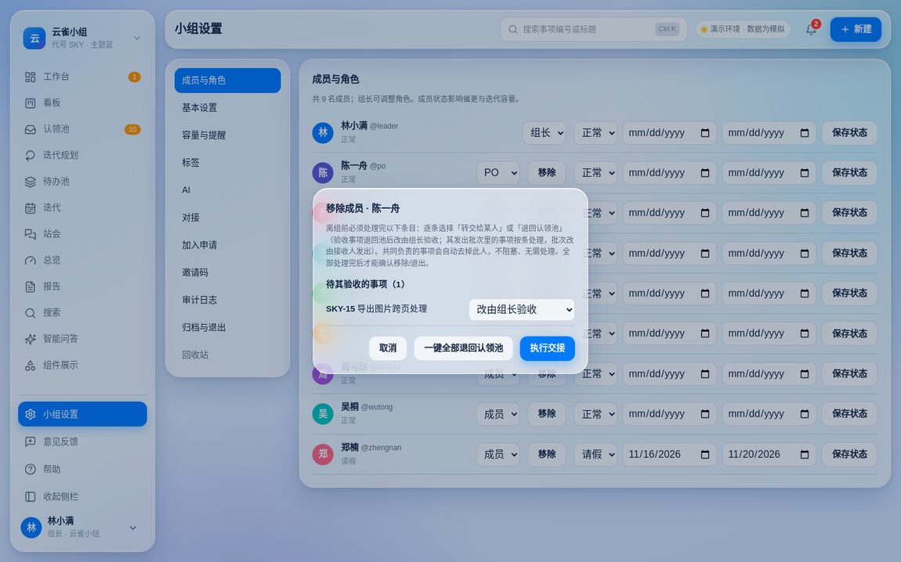

**建迭代与规划**

在「迭代」页新建迭代（名称、目标、起止日期），到「迭代规划」把故事放进来：页面会显示每位成员的剩余容量，超容量只提示。迭代开始后才能启动计时类提醒；规划中的迭代可以先认领，不产生逾期提醒。

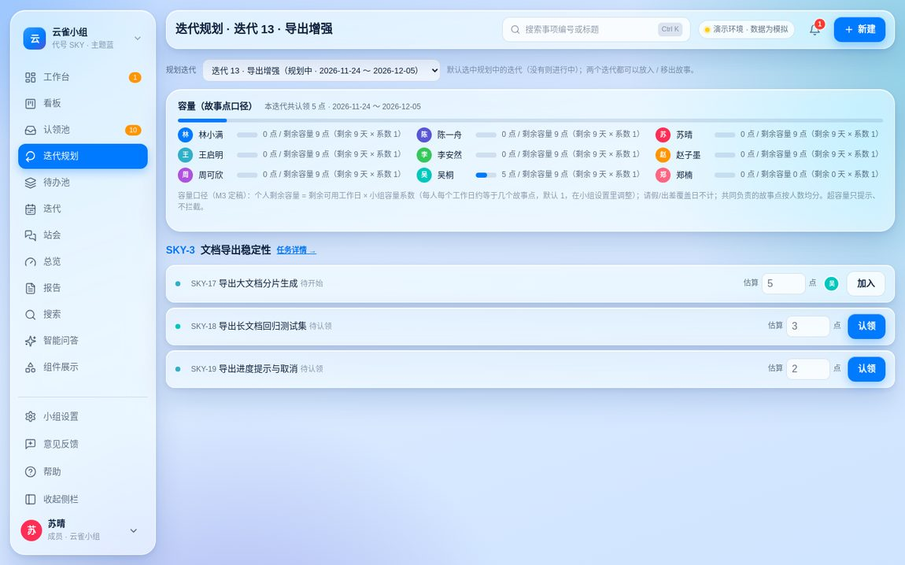

**开站会**

「站会」页按人列出昨日进展、今日计划和阻塞，投屏即可开会。页面上方有「摘要数据截至 HH:MM」：摘要是定时汇总的，组长和 PO 可以点刷新（1 分钟内只能刷一次）；逐人卡片始终是实时数据，不用等刷新。页面下方有全组共享的站会备注，按天保存。

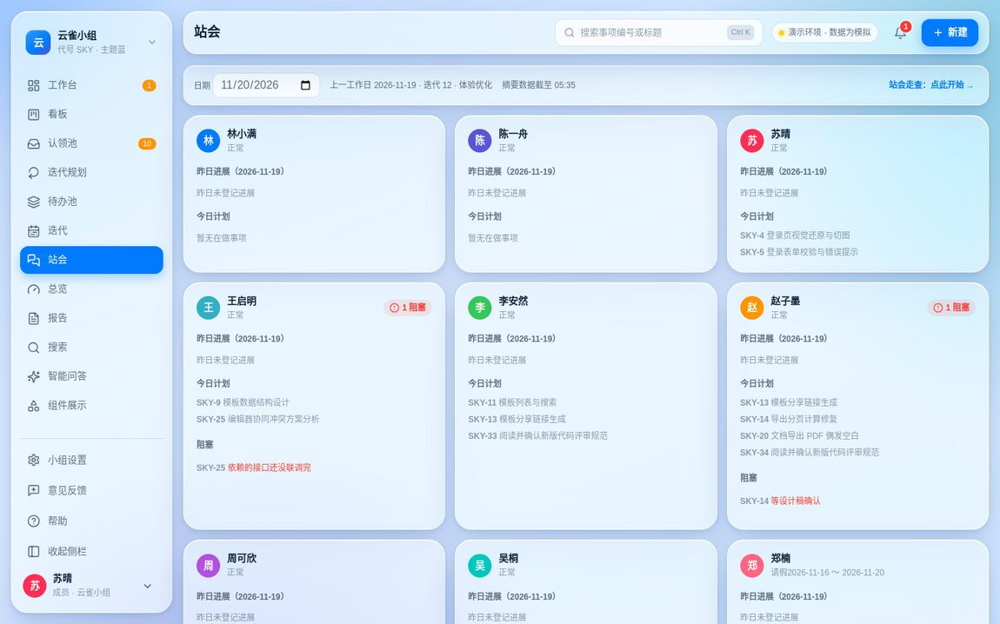

**看总览和风险**

「总览」页看四件事：剩余估算与理想线的差距、阻塞数、长期未更新数、完成率；下面是成员负载表（在做几件、剩余点数、剩余容量、是否空闲）。注意口径：进行中的独立事项（缺陷/分析/临时事项）计入个人负载和总览，但不计入燃尽图，迭代总结里单列为「迭代外工作」。

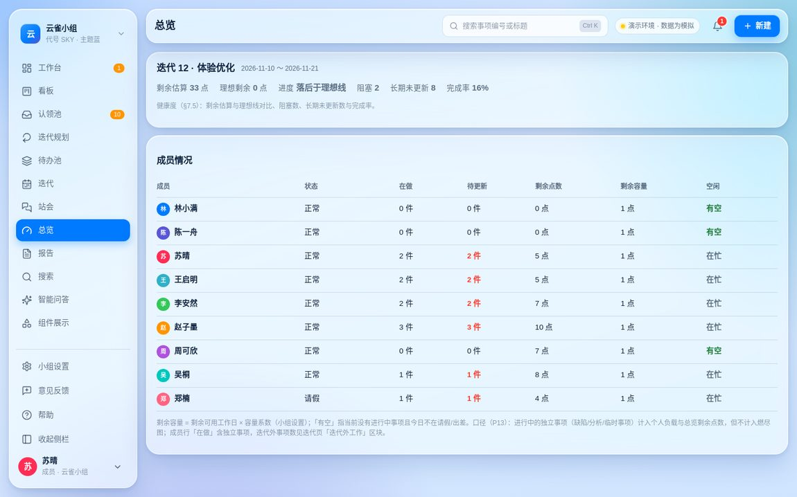

**结束迭代**

在「迭代」页点「结束迭代」：确认框会写清后果——未完成事项默认结转到已规划的下一迭代，你也可以逐条改为退回待办池；系统会生成迭代总结报告（含「迭代外工作」单列）和复盘改进项。结束后 24 小时内可以「撤销结束」，恢复到结束前状态（自动生成的改进项和总结会被删除；若改进项已有人动过，会提示并保留）。

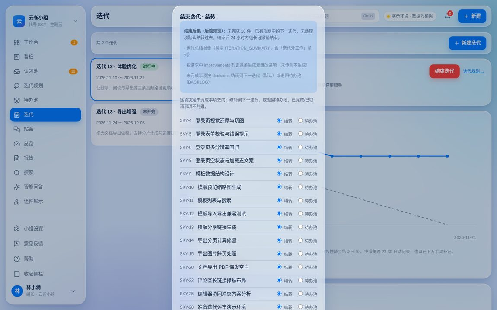

**报告**

在「报告」页生成周报或迭代报告（见 3.5）。迭代详情里还有燃尽图（快照每晚 23:30 自动记录，也可手动补记）和关键日期（封版、评审、投产等，在迭代页登记）。

### 3.4 平台管理员：管全平台

平台管理员管的是「全平台」，不是某个小组。入口在侧栏「平台管理」（只有管理员看得见），四个页签：

- **账号**：全部账号列表。可以授予/撤销平台管理员、停用账号。保护规则：最后一名启用中的管理员不可撤销、不可停用；请至少保留两名管理员。停用账号前，要先完成该账号在每个小组的离组交接（见 3.3）。
- **小组**：全平台小组列表与基本管理。
- **系统信息**：程序版本、数据库与表结构迁移版本、安装目录、数据目录大小、最近一次备份的时间与结果、AI 连接状态、本机局域网访问地址。同事说打不开时，先来这里核对访问地址和端口。
- **审计日志**：全平台范围的关键操作记录（含 reset-admin 的应急重置记录）。

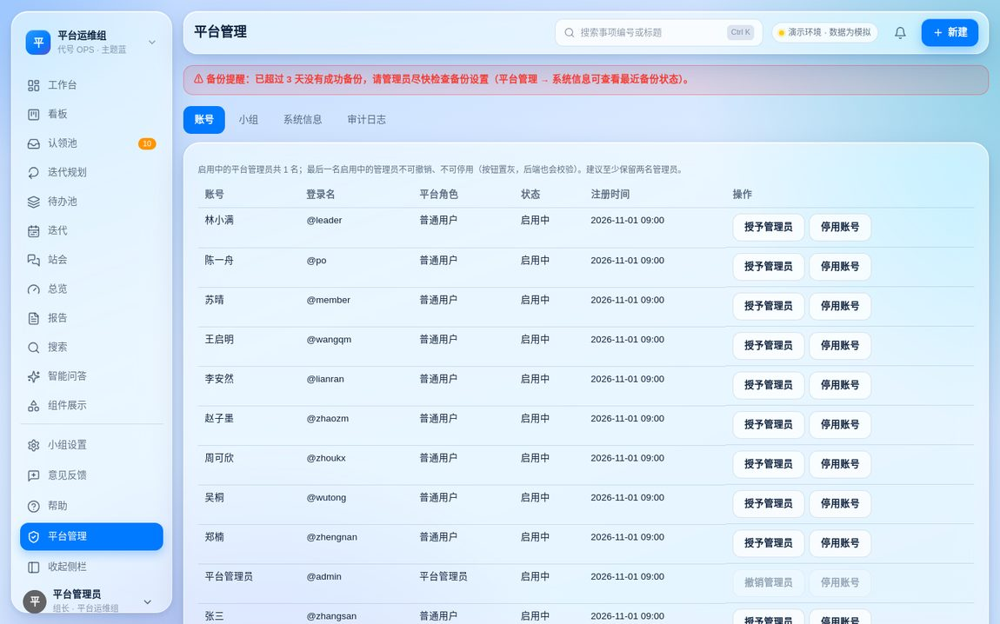

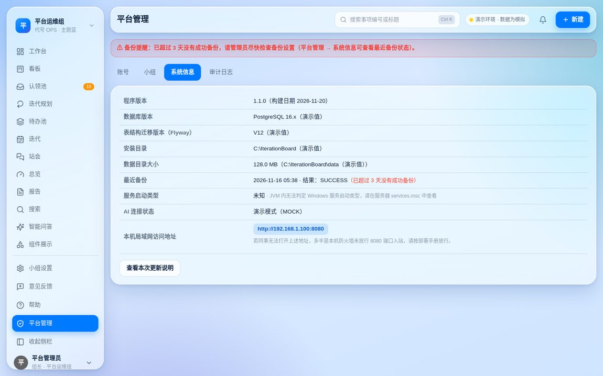

另外两件事归你管：

- **备份健康**：超过 3 天没有成功备份时，管理员登录后页面顶部会出现红色提醒横幅，看到就按第六章排查。
- **意见反馈处理**：在「意见反馈」页把用户反馈流转状态（新提交 → 分析中 → 已采纳/不采纳 → 已上线），必要时导出汇总。

**关于 admin 账号**：安装时生成的 `admin` 是应急账号。日常请用你自己的个人账号（授予管理员后）操作，admin 只在「所有管理员都登不上」时配合 `reset-admin.bat` 使用（见 6.6）。

### 3.5 报告：生成与导出（组长/PO 常用）

在「报告」页：

1. 选周期，点「生成」——程序按结构化数据自动生成（完成清单、进行中、风险），数字准确。
2. 也可以点「AI 汇总生成」——生成稿会带「AI 生成」标记，表述更顺，但数字仍以程序统计为准，发送前请核对。
3. 一个周期只有一份报告：再次生成是更新同一份，不是多出一份。生成后可以在线编辑，历史版本最多保留 5 个；删掉的报告进统一回收站。
4. 导出方式有四种：导出事项清单 Excel、导出 .md、导出 Word（.docx）、复制为邮件正文（粘贴到邮件里保留标题、列表、表格格式）。

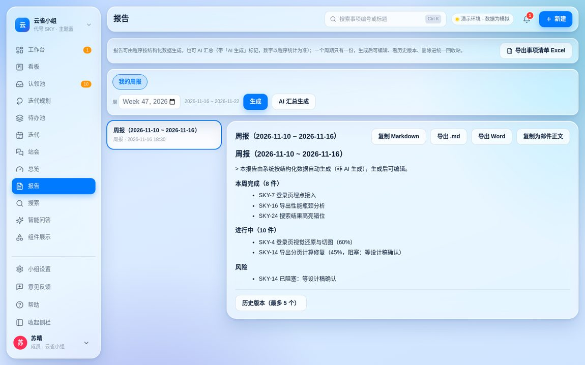

---

## 第四章 常见场景问题

你要做的是：遇到下面这些情况时，直接照对应条目处理，不用问人。

**我被指派了一个不想做（或做不了）的事项，怎么办？**

打开事项点「婉拒」，写明原因（如「手头有 P0 缺陷在处理」）。指派人会收到通知并重新安排。不要直接晾着——晾着会被催办，催办次数还会显示在卡片上。

**事项卡住了，怎么告诉大家？**

在事项里勾「阻塞」，写一句话原因（见 3.1）。只写「阻塞」两个字没用，必须写清在等什么、等谁。组长会在站会和总览里看到并协调。被催时点「卡住了」也是同样的效果。

**我要请假一周，怎么处理？**

提前在「个人设置 → 我的成员状态」设置请假和起止日期（见 3.1）。保存时系统会列出请假期间到期的事项，先把它们转交或和组长商量改期。请假期间不用看平台：催办改催组长，容量按 0 算。回来后把状态改回「正常」。

**我认领错了事项，怎么退？**

打开事项，把负责人改回未认领（退回认领池）或直接转交给正确的人。刚认领、还没动工的退回去没有任何影响；已经写了进展的，先在进展里说明一句再转交，接手的人能看懂。

**报告为什么不能再生成一份新的？**

一个周期（同一周/同一迭代）只有一份报告，这是设计如此，避免出现多个版本互相打架。点「生成」会更新现有那份；想保留旧稿，先看报告的历史版本（最多 5 个），或先导出一份 Word/Excel 存档，再重新生成。

**为什么我看不到某个按钮（验收、结束迭代、平台管理……）？**

多半是权限：验收只有验收人能点，且不能验收自己负责的事项；结束迭代只有组长能点；「平台管理」只有平台管理员能看到入口；小组设置的管理项只有组长能改。如果角色没错还是看不到，刷新页面再试，还不行就提意见反馈（第七章之外，见 3.4 与本章最后一条）。

**为什么桌面通知开关是灰的？**

因为你正在用 `http://局域网IP:端口` 访问，不是浏览器认可的「安全来源」（见 2.8）。这不影响使用：标签页标题未读数和图标红点角标照常工作。想要桌面通知，需要管理员按《部署手册》第 7 节启用 HTTPS 后，用 https 地址访问。

**为什么我没收到桌面通知？**

按顺序查：平台网页是否还开着（关掉浏览器就收不到，建议固定标签页）；桌面通知开关是否打开；浏览器系统通知权限是否被禁；你看的那个标签页是不是正处在最前面（在最前面时故意不弹）。

**同名的同事怎么区分？**

同一组里有重名时，选人列表和显示姓名处会自动附带登录名（如「张三（zhangsan2）」），按登录名认人不会错。

**我把事项删错了怎么办？**

去小组设置的「回收站」恢复，事项会回到删除前的状态。只有彻底删除才不可恢复，那一步要谨慎。

**发现平台有问题或想要新功能，去哪说？**

点侧栏「意见反馈」：选类型（问题/建议/其他），标题写清一句话现象，描述写清操作步骤和看到的结果，可以直接粘贴截图（最多 5 张，每张 ≤ 5MB）。提交时系统自动附带你所在的页面、版本号和浏览器信息。别人提过的就点 +1，不要重复提交；每人每天最多提交 20 条。管理员会把状态流转给你看：新提交 → 分析中 → 已采纳/不采纳 → 已上线。

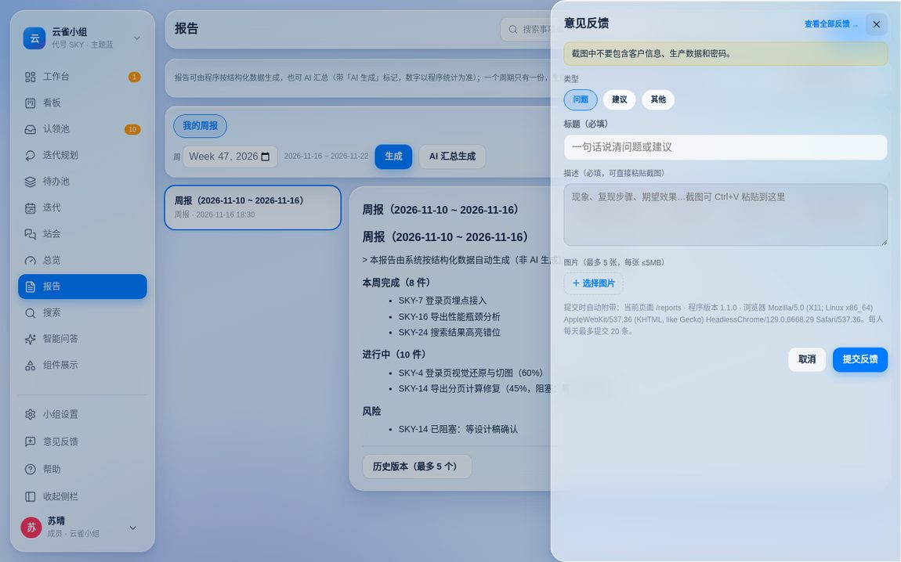

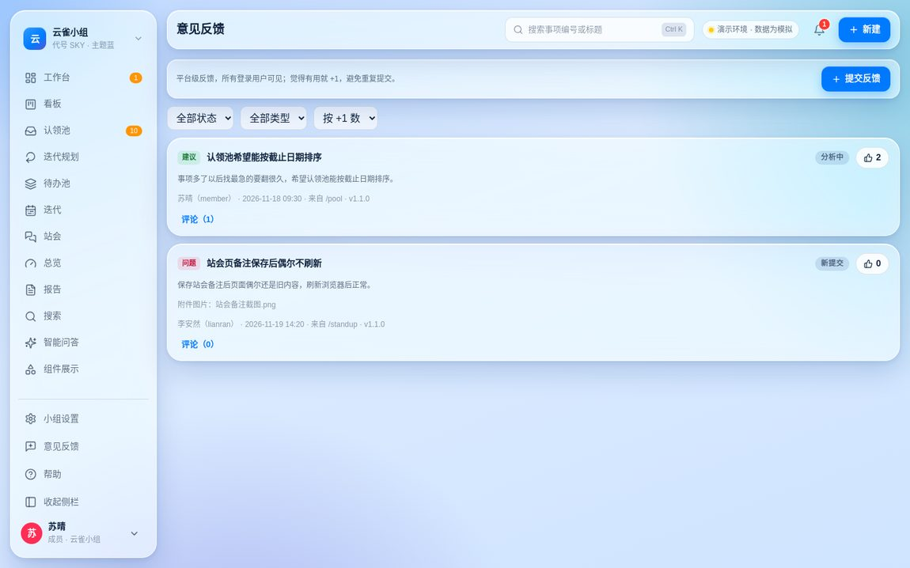

---

## 第五章 AI 功能说明

你要做的是：把 AI 当草稿助手用——它出初稿，你核对确认后才算数。AI 需管理员先在平台配置中接通（行内 DeepSeek），并在小组设置里开启对应功能；未开启时入口不显示或显示不可用。

**红线先说清：不要输入客户信息、生产数据、密码和密钥。** 登录页也有同样的提醒。AI 只能看到当前小组的数据，看不到其他小组。

| 功能 | 在哪里 | 做什么 | 注意 |
| --- | --- | --- | --- |
| 粘贴导入 | 认领池/待办池 →「粘贴导入」 | 把一段会议纪要、清单文本（或 Excel/CSV 文件）拆成多条事项草稿，逐条勾选、修改后批量建单 | 不勾选的不会创建；标题和估算要逐条扫一眼 |
| 一句话更新 | 工作台顶部、事项里的「速记更新」 | 输入一句口语进展（如「登录页联调完了，还差异常提示」），AI 对上号到你负责的事项并转成结构化进展 | 确认对上号的是正确事项再提交 |
| AI 拆故事 | 任务/故事详情 →「拆分故事」 | 把一个大故事拆成若干子故事草稿，含标题与估算建议 | 组长和 PO 都能用；估算只是建议，按团队口径改 |
| 事项摘要 | 事项详情 →「摘要」 | 对评论多、周期长的事项生成一段摘要：目标、进展、关键决定、遗留问题 | 适合接手别人事项时快速上手，细节仍以原评论为准 |
| 风险摘要 | 总览/报告页 →「风险摘要」 | 汇总本迭代逾期、阻塞、无人跟进等风险点成清单 | 仅组长与 PO 可见 |
| AI 汇总报告 | 报告页 →「AI 汇总生成」 | 在程序统计的基础上生成表述完整的报告稿，带「AI 生成」标记 | 数字以程序统计为准，发送前核对 |
| 智能问答 | 侧栏「智能问答」 | 用自然语言提问（如「上个迭代为什么延期？」），AI 基于本组事项与评论作答并给出引用，点引用可打开事项 | 答非所问时换个问法、补充时间范围；问答历史可回看 |

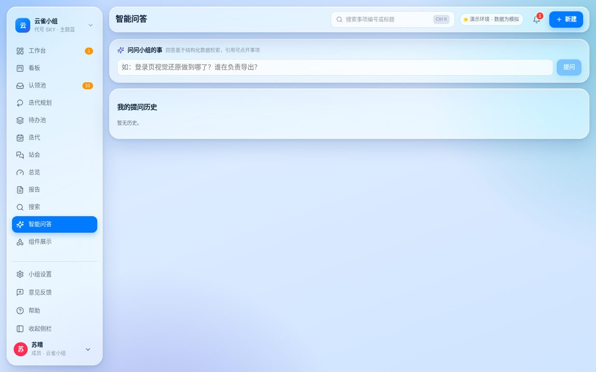

通用原则：

1. AI 的所有结果都是**草稿**，确认后才写入数据；没确认的关掉就没了，不会偷偷生效。
2. 数字、日期、故事点这类硬信息，确认时重点核对。
3. AI 不可用（未配置、网络不通）时，其余功能不受影响，照常用手工方式操作。

---

## 第六章 管理员与运维篇

你要做的是：负责装平台、保运行的管理员看这一章。本章只给要点和检查口径，**具体命令与参数以随包《部署手册》为准**，两份文档冲突时以《部署手册》为准。

### 6.1 安装与管理员账号

- 安装包是分卷的：合并、校验 SHA-256、解压到不含中文和空格的路径，以管理员身份运行 `install.bat`。细节见《部署手册》第 2、3 节。
- 1.1.0 起，`install.bat` 会自动创建内置平台管理员账号 `admin`：初始密码（20 位随机）只显示在安装结束的窗口里，并写入 `config\admin-initial-password.txt`。用 admin 首次登录会被强制改密，改密成功后该密码文件会被自动删除。之后注册的账号都是普通用户，管理员身份只能由已有管理员在「平台管理 → 账号」里授予。请至少保留两名平台管理员，并建议日常用个人账号、admin 只作应急。
- 服务默认手动启动、不开机自启：重启电脑后要运行 `start.bat` 才能用；需要自启的安装时加 `--autostart` 参数（见《部署手册》第 3 节）。

### 6.2 启动、停止与访问地址

- 启停：管理员运行安装目录的 `start.bat` / `stop.bat`（stop.bat 在停止前会自动备份一次）。
- 端口：默认 18080，在 `config\application.yml` 的 `server.port` 修改后重启生效。数据库端口 15432 只供本机，不要对外放行。
- 同事访问地址：`http://<服务器IP>:18080/`，需在防火墙放行应用端口入站。当前地址可在「平台管理 → 系统信息」里核对。建议给服务器设固定内网 IP。
- 桌面通知与 HTTPS 的关系：局域网用 HTTP 访问时桌面通知不可用（见 2.8），启用 HTTPS 的做法（内部证书优先、自签证书备选、Caddy 反向代理示例）见《部署手册》第 7 节。

### 6.3 备份与恢复

- 自动备份每天凌晨 2:00 由计划任务执行，落在 `backup\`（目录可在配置里改到其他盘，见《部署手册》8.1），保留 30 天。注意：备份时服务没在运行会被跳过，只在 `logs\backup.log` 留一行 [SKIP]，不会自己把服务拉起来。
- 1.1.0 的启停自动备份：`stop.bat` 停止前自动备份一次；`start.bat` 启动时若距上次成功备份超过 24 小时，会先备份再启动。备份失败不阻止启动/停止，但会提示并记录在 `data\backup-status.json`，「系统信息」页据此显示最近备份情况。
- 超过 3 天没有成功备份：管理员登录后页面顶部有红色横幅提醒，看到要当天处理。
- 恢复：运行 `restore.bat` 选备份文件夹；脚本会先对当前状态做一次安全备份再恢复，恢复失败可再用安全备份退回。
- 备份文件夹里含配置副本（内有口令与密钥），按敏感文件管理，并定期拷一份到另一台机器或移动硬盘。

### 6.4 升级与回滚

1. 新版包解压到临时目录，以管理员身份运行新包里的 `upgrade.bat <现有安装目录>`；增量补丁则运行补丁里的 `apply-patch.bat`。
2. 脚本会自动：先备份数据库并把将被替换的程序文件打包成回滚包（备份目录下 `upgrade-<日期时间>\`）→ 停服换文件 → 启服（数据库结构自动迁移）→ 健康检查。检查失败会打印日志末尾并明确给出一行回滚命令，不会假报成功。升级到 1.1.0 时若还没有 admin 账号，会按 6.1 的方式自动创建。
3. 升级后冒烟：登录、看板、事项详情各点一次，并核对「系统信息」里的版本号。
4. 回滚：在安装目录运行 `rollback.bat`，默认用最近一次回滚包，程序文件和数据库一起退回升级前；回滚前还会再做一次安全备份，所以回滚本身也能再撤销。

### 6.5 迁移到另一台电脑

把平台搬到另一台电脑，全程不需要手工拷数据库目录（详见《部署手册》第 9 节）：

1. 新电脑先用同版本或更新版本安装包装好平台，不要录入正式数据。
2. 旧电脑运行 `migrate-export.bat` 生成迁移包（数据库、贴图、业务配置和清单）。迁移包超过约 98 MB 会自动分卷，并生成合并脚本和校验文件，要一起带走。数据库口令不进迁移包，任何密码文件也不会被导出；迁移包含 AI 密钥，按敏感文件对待。
3. 新电脑运行 `migrate-import.bat <迁移包路径>`：先校验清单和哈希，再做版本检查（迁移包版本高于新机已装版本时拒绝导入，先升级新机），自动备份新机现有数据库后再导入。
4. 导入后登录验证用户、小组、事项、贴图、报告与旧机一致。
5. 地址变化：新电脑 IP 一般不同，提前在组内通知新地址；同事的旧书签和「安装为应用」快捷方式要换；若用了 HTTPS，证书要按新机名称/IP 重新签发。
6. 旧电脑先 `uninstall.bat` 卸载服务，安装目录和最后一次迁移包建议保留 2–4 周再删。

### 6.6 重置管理员（reset-admin）

所有平台管理员都登不上（忘密码、管理员离职）时，在服务器上以管理员身份运行 `reset-admin.bat`（默认重置 admin，也可带登录名重置其他账号）：脚本把该账号设为平台管理员、解除锁定/停用，并生成随机临时密码**只显示在窗口里、不写任何文件**，当场记下；用临时密码登录后会被强制改密。每次重置都会写进平台审计日志（动作 `ADMIN_RESET_VIA_SCRIPT`），事后在「平台管理 → 审计日志」可查。这是应急通道，日常改密请在个人设置里做。

### 6.7 常见故障排查

先看现象对表；更完整的排查表见《部署手册》第 11 节。

| 现象 | 先查什么 |
| --- | --- |
| 浏览器打不开登录页 | 两个服务是否在运行（没运行就 `start.bat`）；端口与配置是否一致；局域网访问查防火墙放行 |
| 重启电脑后平台打不开 | 默认手动启动属正常，运行 `start.bat` 即可 |
| 服务启动失败、一闪而退 | 看 `logs\` 下应用与数据库日志末尾几行；常见是配置写错、磁盘满、目录权限被改 |
| 页面能开但登录/数据报错 | 多半是数据库服务没起：先启动 PostgreSQL 服务，再重启应用服务 |
| 桌面通知开关是灰的 | 当前是 http 局域网地址访问，不是安全来源；按 6.2 启用 HTTPS。标题未读数与角标不受影响 |
| 通知不到（站内也没有） | 先看铃铛里有没有：没有多半是对方操作未成功或通知类别被关（个人设置里查；指派/催办关不掉，若这两类也没有，提意见反馈并附页面信息） |
| 备份任务没执行 | 任务计划里查 IterationBoardBackup 是否存在启用；凌晨服务器是否开机；服务没运行时跳过是正常行为，查 backup.log 的 [SKIP] |
| 忘记管理员密码 | 先找另一名管理员重置；全体都登不上时用 6.6 的 reset-admin.bat，不要直接改数据库 |
| 升级后打不开 | 先看升级脚本打印的日志末尾；决定回滚就运行 `rollback.bat`（见 6.4） |
| AI 功能显示不可用 | 查平台 AI 配置是否填好、`mode` 是否为 live，再按《部署手册》第 10 节做连通性自检 |

---

## 附录

### 附录 A 快捷键

| 快捷键 | 功能 |
| --- | --- |
| `Ctrl+K`（Mac 为 `Cmd+K`） | 呼出顶部搜索，按编号或标题找事项 |
| `Esc` | 关闭当前弹窗/抽屉 |
| `Enter` | 在搜索框中确认搜索；在单行表单中提交（多行文本框内为换行） |

其余操作以鼠标点按为主；看板卡片在触屏设备上长按后拖动。

### 附录 B 权限总表（简化版）

| 事项 | 成员 | PO | 组长 | 平台管理员 |
| --- | --- | --- | --- | --- |
| 看工作台/看板/站会/总览 | ✓ | ✓ | ✓ | ✓（需在组内） |
| 认领、更新自己负责的事项进展 | ✓ | ✓ | ✓ | ✓（需在组内） |
| 建独立事项（缺陷/分析/临时事项） | ✓ | ✓ | ✓ | ✓（需在组内） |
| 建任务、拆故事、维护待办池 | — | ✓ | ✓ | — |
| 粘贴导入、AI 拆故事 | — | ✓ | ✓ | — |
| 验收故事/任务 | 仅被指定为验收人时 | ✓ | ✓ | — |
| 建迭代、规划、结束/撤销结束迭代 | — | 部分（规划） | ✓ | — |
| 生成报告 | 看与自己相关部分 | ✓ | ✓ | — |
| 小组设置、成员与角色、邀请码、加入审批 | — | — | ✓ | — |
| 平台管理（账号/小组/系统信息/全平台审计） | — | — | — | ✓ |
| 意见反馈提交与 +1 | ✓ | ✓ | ✓ | ✓ |
| 意见反馈状态流转与导出 | — | — | — | ✓ |

注：平台管理员是平台级角色，不自动拥有某个小组内的组长权限；在小组内行事时按其小组角色计。不能验收自己负责（含共同负责）的事项，这条对所有角色都成立。

### 附录 C 状态流转表

同 2.2 的流转表，此处再补两个特殊状态：

| 状态/标记 | 含义 | 怎么进入 | 怎么离开 |
| --- | --- | --- | --- |
| 已取消 | 事项不做了，保留记录 | 创建人或组长取消 | 看板勾「显示已取消」可查看，一般不再恢复 |
| 阻塞（标记） | 进行中但被卡住，必须有原因 | 负责人勾选阻塞/被催时点「卡住了」 | 点「解除阻塞」 |
| 待验收 | 做完等验收 | 负责人点「提交验收」 | 验收人通过（→已完成）或打回（→进行中） |

迭代状态：规划中（未开始）→ 进行中 → 已结束；已结束的迭代在 24 小时内可由组长撤销结束，回到进行中。

### 附录 D 名词解释

| 名词 | 解释 |
| --- | --- |
| 事项 | 平台的基本工作单元：任务、故事、缺陷、分析、临时事项五类 |
| 故事点 | 工作量的相对估算单位，不是工时；用于容量计算 |
| 容量 | 一名成员一个迭代能承担的故事点上限口径：剩余可用工作日 × 容量系数 |
| 待办池 | 存放任务的列表，由 PO 维护优先级 |
| 认领池 | 无人负责的事项集合，成员自助认领 |
| 燃尽图 | 迭代详情里的剩余估算曲线：实线为实际剩余，虚线为理想线 |
| 迭代外工作 | 进行中的独立事项的统称口径：计入负载与总览，不计入燃尽图，迭代总结单列 |
| 每人一份 | 把同一事项批量下发给多人，每人一份、独立完成 |
| 催一下 | 对停滞事项的提醒动作；被催方需用「马上更新/今天搞定/卡住了」回应 |
| 精简通知 | 个人设置开关：只保留六类关键通知，同一事项 5 分钟内变化合并为一条 |
| 安全来源 | 浏览器认可的地址：HTTPS 地址或本机 localhost；决定桌面通知能否开启 |
| 离组交接 | 成员离开小组前，把其未完成事项、待其验收事项、发出的批次逐条转交或退回认领池的过程 |
| reset-admin | 服务器上的应急脚本：全体管理员登不上时重置管理员账号 |

### 附录 E 版本记录

| 版本 | 日期 | 说明 |
| --- | --- | --- |
| 1.1.0 | 2026-11-20 | 随平台 1.1.0 首发。覆盖：安装生成 admin 账号与首登改密、浏览器通知三层与桌面通知安全来源限制、意见反馈、离组交接、迁移与回滚、reset-admin、精简通知、报告导出 Word/复制为邮件正文、站会摘要数据截至时间；同版追加：状态与进度联动（拖满 100% 就地提示、待开始拖动自动开始可撤销、退回保留进度）、全平台浮层统一（菜单不再被抽屉裁切、实色不透底）、深色主题（暮光蓝灰/石墨/跟随系统，账号保存）、品牌图标定稿（标签页图标、未读红点、AI 入口金色星芒） |
