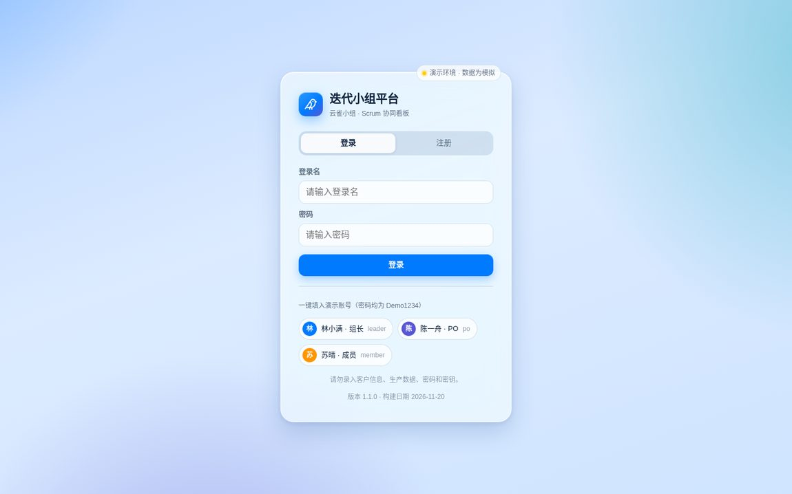
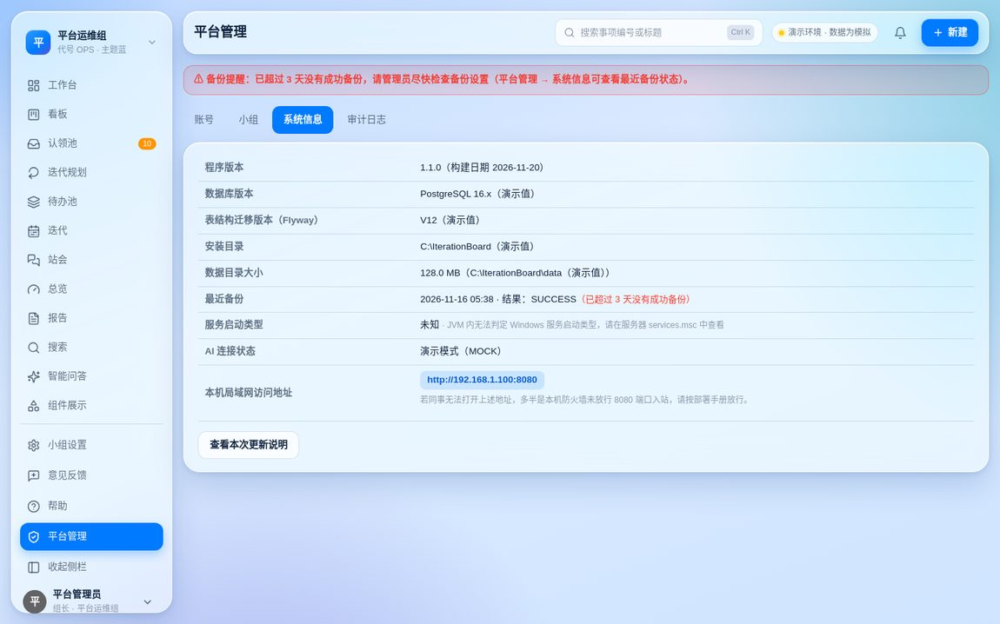
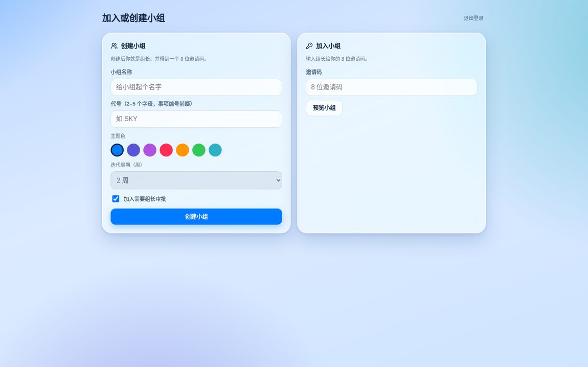
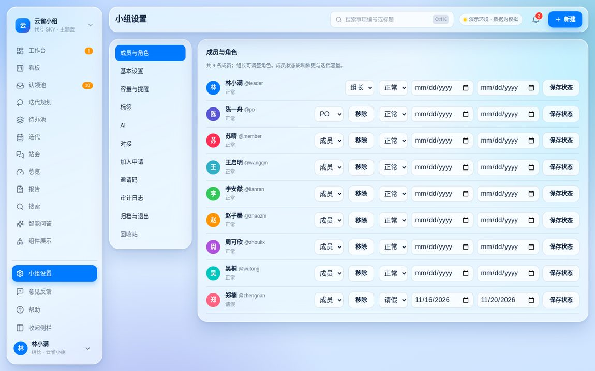
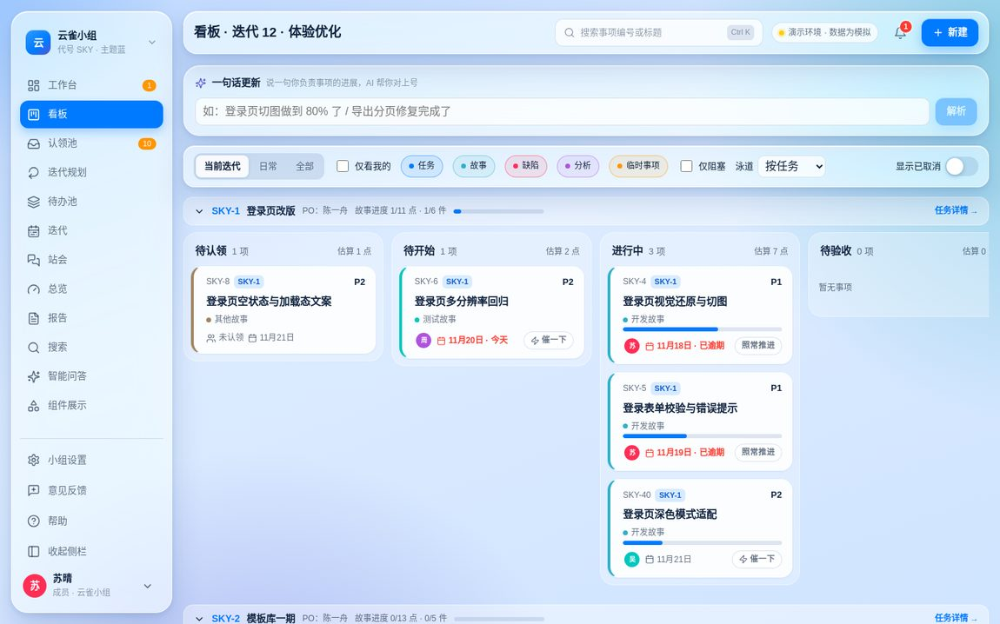
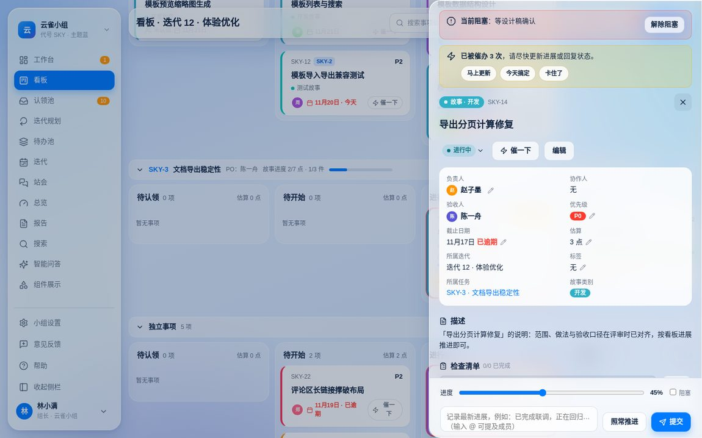
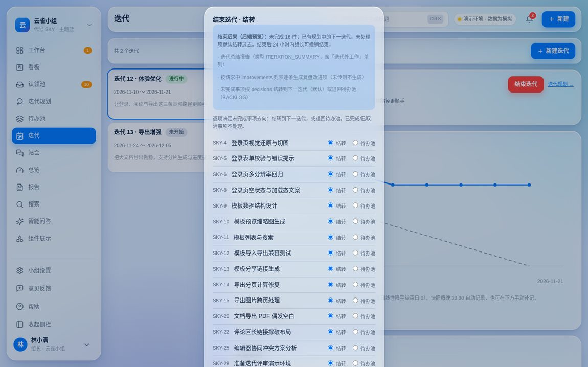
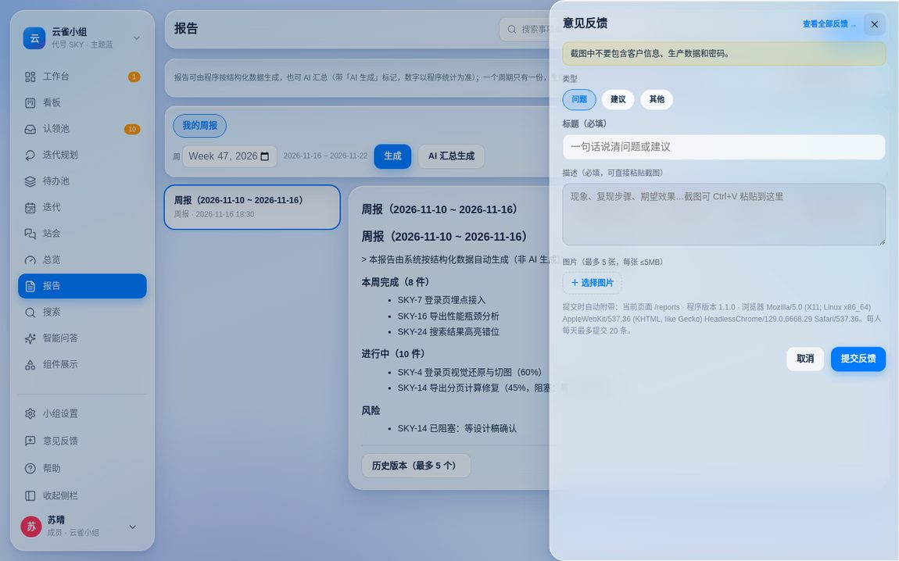

# 迭代小组平台 · 真人真机测试流程

**版本 1.1.0**
**日期：2026-11-20**

适用对象：参与验收测试的同事（不需要技术背景，照着做即可）。
测试目标：在真实 Windows 电脑、真实浏览器上，把平台从安装到日常使用的完整流程走一遍，确认可以给全组正式使用。

文中出现的小组、姓名、事项（云雀小组、林小满、SKY-4 等）均为演示示例；实际测试时请换成你们自己的小组和事项，步骤不变。

---

<!-- doc-toc-start -->

## 目录

- 测试总览 / 测试前准备
- 阶段 1 安装与启动 / 阶段 2 建组与加人 / 阶段 3 一个迭代的完整流程 / 阶段 4 日常安排 / 阶段 5 多人实时
- 阶段 6 权限 / 阶段 7 异常情况 / 阶段 8 运维 / 阶段 9 AI 功能 / 阶段 10 意见反馈
- 发现问题怎么报告 / 测试结论 / 版本记录

<!-- doc-toc-end -->

## 测试总览

你要做的是：和几位同事分工扮演不同角色，按阶段 1 到阶段 10 的剧本一步步操作，每一步都在表格里勾选「通过 / 不通过」，发现问题就记下来并按文末说明提交。全部阶段可以分几天做完，不必一次做完。

| 阶段 | 内容 | 目标 | 预计用时 | 必测 / 可选 |
| --- | --- | --- | --- | --- |
| 阶段 1 | 安装与启动 | 平台能装上、能打开，管理员账号口径正确，同事能从另一台电脑访问 | 40 分钟 | 必测 |
| 阶段 2 | 建组与加人 | 建好小组，成员通过邀请码加入，角色分配正确 | 30 分钟 | 必测 |
| 阶段 3 | 一个迭代的完整流程 | 从建任务、拆故事、规划、认领、进展、阻塞、催办、验收到结束迭代，全程走通 | 90 分钟 | 必测 |
| 阶段 4 | 日常安排 | 每人一份、直接指派、认领池、请假成员的处理都符合预期 | 40 分钟 | 必测 |
| 阶段 5 | 多人实时 | 两人同时在线时，通知、角标、数据变化能实时到达 | 20 分钟 | 必测 |
| 阶段 6 | 权限 | 每个角色能看的、能做的、不能做的与权限总表一致 | 40 分钟 | 必测 |
| 阶段 7 | 异常情况 | 重复点击、两人同时改、刷新、断网、重启服务后数据不丢、不乱 | 30 分钟 | 必测 |
| 阶段 8 | 运维 | 停止/启动、备份、恢复、升级、回滚、迁移到另一台电脑都能完成 | 90 分钟 | 必测（迁移可放到最后单独做） |
| 阶段 9 | AI 功能 | 接上行内 DeepSeek 后，五项 AI 能力可用且结果需人工确认 | 40 分钟 | 可选（未接 AI 时跳过） |
| 阶段 10 | 意见反馈 | 带截图提交反馈、+1、管理员处理流转完整 | 20 分钟 | 必测 |

合计约 7 小时（不含阶段 9）。建议顺序：第一天做阶段 1–3，第二天做阶段 4–7，第三天做阶段 8、10，阶段 9 在 AI 接通后补测。

## 测试前准备

你要先备齐下面这些东西，后面每个阶段才不会卡住。

**电脑与浏览器**

- 至少 2 台 Windows 电脑：一台作服务器（装平台），一台作同事电脑。阶段 5、7 最好有第 3 台或第 2 个浏览器。
- 一个人扮演多个账号时：在同一台电脑上用 Chrome 普通窗口 + 无痕窗口，或 Chrome + Edge，分别登录不同账号。不要在同一个浏览器窗口里反复退出登录切换账号，容易串号。

**要准备的账号**（阶段 1、2 中创建，之后全程沿用）

| 账号（本文称呼） | 谁来扮演 | 说明 |
| --- | --- | --- |
| 平台管理员 | 服务器电脑的操作者 | 安装时系统自动生成的 `admin` 账号，不是自己注册的（见 T1-03） |
| 组长 | 同事甲 | 建小组的人自动成为组长 |
| PO | 同事乙 | 由组长在小组设置里把角色改成 PO |
| 成员 A | 同事丙 | 普通成员 |
| 成员 B | 同事丁 | 普通成员，与成员 A 配合做双人步骤 |
| 另一小组成员 | 同事戊（可由成员 B 兼任） | 另建一个小组，只在阶段 6 用到 |

**其他**

- 一个迭代的完整流程（阶段 3）需要组长、PO、成员 A 三个账号同时在线，建议约好同一时间段。
- 阶段 8 的恢复、回滚、迁移会真实替换数据，请在测试数据上做，不要拿正式数据试。
- 截图工具：Windows 自带截图（Win + Shift + S）即可，后面提交问题时要用。

---

## 阶段 1 安装与启动（预计 40 分钟）

你要做的是：把平台装到服务器电脑上，确认管理员账号的来源符合 1.1.0 的新口径，并让另一台电脑能打开平台。

| 编号 | 谁来做 | 操作 | 预期结果 | 结果 | 备注 |
| --- | --- | --- | --- | --- | --- |
| T1-01 | 平台管理员 | 按《部署手册》第 2 节合并分卷、校验 SHA-256，解压到只含英文、数字和空格的路径（如 `D:\IterationBoard`）；另可顺手验证：解压到中文文件夹运行 install.bat 应被明确拦下并提示换路径 | 校验显示「通过」；解压后根目录有 install.bat、start.bat、stop.bat 等脚本和 app、config、data 等文件夹 | □通过 □不通过 |  |
| T1-02 | 平台管理员 | 右键 `install.bat` →「以管理员身份运行」，等它跑完 | 最后显示「Installation complete」；中途若提示端口被占用，按提示换一个端口继续，不要装完才发现 | □通过 □不通过 |  |
| T1-03 | 平台管理员 | 看安装结束的窗口，并打开安装目录下 `config\admin-initial-password.txt` | 窗口里和该文件里都有内置管理员账号 `admin` 的初始密码（20 位随机密码）；注意：1.1.0 起管理员是安装时生成的这个 admin 账号，**不是**「第一个注册的账号」 | □通过 □不通过 |  |
| T1-04 | 平台管理员 | 在服务器电脑浏览器打开 `http://localhost:18080/`（端口以实际安装为准），用 admin + 初始密码登录 | 被要求先修改密码（首次登录强制改密）；改密成功后能进入平台 | □通过 □不通过 |  |
| T1-05 | 平台管理员 | 回到安装目录看 `config\admin-initial-password.txt` 是否还在（必要时先运行一次 start.bat 再看） | 改密成功后该密码文件已被自动删除，不应长期留在磁盘上 | □通过 □不通过 |  |
| T1-06 | 平台管理员 | 注册一个自己的个人账号，再用 admin 登录，在「平台管理 → 账号」里把个人账号「授予管理员」 | 个人账号成为平台管理员；此后日常用个人账号，admin 只作应急。平台里至少有 2 名管理员 | □通过 □不通过 |  |
| T1-07 | 平台管理员 | 在服务器上运行 `ipconfig` 记下内网 IP，按《部署手册》第 6 节放行防火墙端口 | 防火墙入站规则已放行应用端口（默认 18080）；数据库端口 15432 不要放行 | □通过 □不通过 |  |
| T1-08 | 成员 A（另一台电脑） | 在同事电脑浏览器打开 `http://<服务器IP>:18080/` | 能看到登录页，页面底部版本号为 1.1.0 | □通过 □不通过 |  |
| T1-09 | 平台管理员 | 在服务器上运行 `stop.bat`，再运行 `start.bat`，然后刷新同事电脑上的页面 | 停止期间页面打不开属正常；启动后页面恢复，之前的数据（账号）都还在 | □通过 □不通过 |  |
| T1-10 | 平台管理员 | 打开「平台管理 → 系统信息」 | 能看到程序版本 1.1.0、安装目录、最近备份、本机局域网访问地址等信息，与实际一致 | □通过 □不通过 |  |

**本阶段发现的问题**

| 编号（如 T1-03） | 问题描述 | 严重程度（高/中/低） | 是否已提交意见反馈 |
| --- | --- | --- | --- |
|  |  |  |  |
|  |  |  |  |
|  |  |  |  |

---

## 阶段 2 建组与加人（预计 30 分钟）

你要做的是：组长建一个小组，其他人用邀请码加入，再把角色分配好。

| 编号 | 谁来做 | 操作 | 预期结果 | 结果 | 备注 |
| --- | --- | --- | --- | --- | --- |
| T2-01 | 组长 | 注册账号并登录（注册时填登录名、显示名、密码；密码至少 8 位且同时含字母和数字） | 注册成功并自动登录；因为还没有小组，直接进入「加入或创建小组」页 | □通过 □不通过 |  |
| T2-02 | 组长 | 在「创建小组」里填小组名称、代号（2–5 个字母）、选主题色和迭代周期，勾选「加入需要组长审批」，点「创建小组」 | 创建成功进入小组工作台；创建人自动成为组长；得到一个 8 位邀请码（在「小组设置 → 邀请码」可看、可重置） | □通过 □不通过 |  |
| T2-03 | 成员 A | 注册账号登录，在「加入小组」里输入组长给的邀请码，点「预览小组」确认是目标小组后提交加入申请 | 提示申请已提交，等待审批；此时还进不了小组工作台 | □通过 □不通过 |  |
| T2-04 | 组长 | 打开「小组设置 → 加入申请」，通过成员 A 的申请 | 成员 A 收到通知；成员 A 刷新后已进入小组，角色为成员 | □通过 □不通过 |  |
| T2-05 | 组长 | 在「小组设置 → 成员与角色」里，把同事乙的角色改为 PO | 角色立即生效；同事乙重新打开页面后，菜单与可操作项按 PO 权限变化（如能维护待办池） | □通过 □不通过 |  |
| T2-06 | 成员 B | 用邀请码加入小组（同 T2-03、T2-04） | 成员 B 成为普通成员 | □通过 □不通过 |  |
| T2-07 | 组长 | 在「小组设置 → 邀请码」点「重置邀请码」，再让另一小组成员用旧邀请码试着加入 | 旧邀请码失效，无法加入；新邀请码可用；重置动作在审计日志里能查到 | □通过 □不通过 |  |
| T2-08 | 成员 A | 在左上角小组切换器和左下角个人区确认显示 | 显示当前小组名、代号，以及自己的姓名和角色「成员」 | □通过 □不通过 |  |

**本阶段发现的问题**

| 编号（如 T2-03） | 问题描述 | 严重程度（高/中/低） | 是否已提交意见反馈 |
| --- | --- | --- | --- |
|  |  |  |  |
|  |  |  |  |
|  |  |  |  |

---

## 阶段 3 一个迭代的完整流程（预计 90 分钟）

你要做的是：用一个真实感的小例子，把「任务 → 故事 → 规划 → 认领 → 进展 → 阻塞/催办 → 验收 → 站会 → 报告 → 结束迭代」整条链走通。建议全程用同一批事项，不要中途换例子。

| 编号 | 谁来做 | 操作 | 预期结果 | 结果 | 备注 |
| --- | --- | --- | --- | --- | --- |
| T3-01 | PO | 在「待办池」点「新建」建一个任务（如「登录页改版」），填标题、说明和验收口径 | 任务出现在待办池，编号形如 `XX-1`；待办池里能看到它下面的故事数和进度（现在是 0） | □通过 □不通过 |  |
| T3-02 | PO | 打开任务详情，在其下新建 3 个故事，分别估算故事点（如 1 点、2 点、3 点） | 3 个故事挂在任务下，待办池里任务进度显示「0/3 故事」 | □通过 □不通过 |  |
| T3-03 | 组长 | 在「迭代」页点「新建迭代」，填名称、目标、起止日期（覆盖今天） | 迭代创建成功，状态为未开始/规划中 | □通过 □不通过 |  |
| T3-04 | 组长 | 进入「迭代规划」，选中刚建的迭代，把 T3-02 的 3 个故事加入迭代；看一眼每位成员的「剩余容量」 | 故事进入迭代；容量按「剩余可用工作日 × 容量系数」显示；超容量只提示、不拦截 | □通过 □不通过 |  |
| T3-05 | 组长 | 在「迭代」页启动该迭代（开始迭代） | 迭代状态变为进行中；看板「当前迭代」能看到这些故事 | □通过 □不通过 |  |
| T3-06 | 成员 A | 在「认领池」找到其中一个故事，点「认领」 | 认领成功有提示；该故事负责人变成成员 A，并出现在成员 A 的工作台「进行中/待开始」里 | □通过 □不通过 |  |
| T3-07 | 成员 A | 在工作台点开刚认领的故事（或在事项抽屉里），把进度拉到约 50%，写一句进展，点「提交」 | 进展保存成功；进展记录里能看到这句话、时间和进度；看板卡片上的更新时间变化 | □通过 □不通过 |  |
| T3-08 | 成员 A | 在同一事项里勾选「阻塞」，填写阻塞原因（如「等设计稿确认」），提交 | 看板卡片上出现「阻塞：等设计稿确认」标识；站会页和总览的阻塞数 +1 | □通过 □不通过 |  |
| T3-09 | 组长 | 在看板上对这个被阻塞的故事点「催一下」 | 成员 A 收到催办通知（铃铛未读 +1，标签页标题出现未读数） | □通过 □不通过 |  |
| T3-10 | 成员 A | 打开被催的事项，点「卡住了」，写一句话原因并提交 | 必须写原因才能提交；提交后该原因成为阻塞原因，组长能看到 | □通过 □不通过 |  |
| T3-11 | 成员 A | 点「解除阻塞」，把进度更新到 100%，点「提交验收」 | 事项进入「待验收」列；验收人收到「待我验收」通知 | □通过 □不通过 |  |
| T3-12 | PO | 在工作台「待我验收」里点「通过」验收这个故事 | 故事变为已完成；所属任务的故事进度 +1 | □通过 □不通过 |  |
| T3-13 | 成员 B | 认领第二个故事，做到 100% 提交验收 | 进入待验收 | □通过 □不通过 |  |
| T3-14 | PO | 对第二个故事点「打回」，写明打回原因 | 故事退回进行中，打回原因可见；成员 B 收到通知 | □通过 □不通过 |  |
| T3-15 | 成员 B | 按打回原因修改后再次提交验收，PO 再次验收通过 | 故事已完成 | □通过 □不通过 |  |
| T3-16 | 组长 | 打开「站会」页，切换到今天 | 每人一张卡片：昨日进展、今日计划、阻塞都对得上前面几步的操作；页面上方显示「摘要数据截至 HH:MM」 | □通过 □不通过 |  |
| T3-17 | 组长 | 在站会页点刷新摘要（组长/PO 可刷新，1 分钟内重复点会被节流） | 摘要数据截至时间更新；逐人卡片始终是实时数据 | □通过 □不通过 |  |
| T3-18 | 组长 | 打开「报告」页，生成本周周报 | 报告按结构化数据生成：本周完成、进行中、风险与前面的操作一致；同一周期只有一份，再点生成是更新同一份 | □通过 □不通过 |  |
| T3-19 | 组长 | 对报告分别试「导出 Word」和「复制为邮件正文」 | Word 文件能打开，标题、列表、表格格式正常；粘贴到邮件里格式保留 | □通过 □不通过 |  |
| T3-20 | 组长 | 在「迭代」页点「结束迭代」，逐条看未完成事项的去向（默认结转到下一迭代，也可改退回待办池），确认结束 | 确认框写清后果（哪些结转/退回、会生成迭代总结和复盘改进项）；结束后迭代状态为已结束，生成迭代总结（含「迭代外工作」单列） | □通过 □不通过 |  |
| T3-21 | 组长 | 在结束 24 小时内点「撤销结束」 | 迭代恢复到结束前的状态；自动生成的改进项和总结被删除（若改进项已有人操作，会提示并保留） | □通过 □不通过 |  |

**本阶段发现的问题**

| 编号（如 T3-12） | 问题描述 | 严重程度（高/中/低） | 是否已提交意见反馈 |
| --- | --- | --- | --- |
|  |  |  |  |
|  |  |  |  |
|  |  |  |  |

---

## 阶段 4 日常安排（预计 40 分钟）

你要做的是：试日常里最常见的四种派活方式，以及有人请假时平台怎么处理。

| 编号 | 谁来做 | 操作 | 预期结果 | 结果 | 备注 |
| --- | --- | --- | --- | --- | --- |
| T4-01 | 组长 | 用「新建 → 每人一份」把一个事项（如「阅读并确认新版规范」）下发给全组，注意默认不勾选「包含我自己」 | 每位成员各收到一份属于自己的事项；组长自己没有这一份；组长在工作台「我发出的」里能看到每个人的完成情况 | □通过 □不通过 |  |
| T4-02 | 组长 | 再发一次每人一份，这次勾选「包含我自己」 | 组长自己也收到一份 | □通过 □不通过 |  |
| T4-03 | 成员 A | 打开自己那份每人一份事项，更新进度到完成并提交验收/确认完成 | 组长在「我发出的」里看到成员 A 那份状态变化；其他人的份不受影响 | □通过 □不通过 |  |
| T4-04 | 组长 | 新建一个独立事项（类型选「临时事项」），直接指派给成员 B | 成员 B 收到「指派给我」通知，事项出现在其工作台；这类通知在个人设置里是关不掉的 | □通过 □不通过 |  |
| T4-05 | 成员 B | 对被指派但确实做不了的事项，点「婉拒」并写明原因 | 婉拒成功，指派人收到通知；事项回到可重新指派状态 | □通过 □不通过 |  |
| T4-06 | PO | 把一个故事「发布到认领池」，不指定负责人 | 故事出现在认领池，显示发布人、故事点、截止日期和已等待天数 | □通过 □不通过 |  |
| T4-07 | 成员 A | 认领错一个事项后，在事项里改回：取消认领/转交负责人给成员 B | 负责人变更成功并有记录；成员 B 收到通知 | □通过 □不通过 |  |
| T4-08 | 成员 B | 在「个人设置 → 我的成员状态」把状态设为请假，填下周一到周五的起止日期并保存 | 保存时列出请假期间到期的事项并提示转交；站会页成员 B 的卡片显示请假及日期；请假期间容量按 0 计算 | □通过 □不通过 |  |
| T4-09 | 组长 | 对请假中的成员 B 名下一个进行中事项点「催一下」 | 催办被改催组长（请假成员不被打扰），页面或通知里有说明 | □通过 □不通过 |  |
| T4-10 | 成员 B | 把成员状态改回「正常」 | 站会、容量、催办恢复正常口径 | □通过 □不通过 |  |

**本阶段发现的问题**

| 编号（如 T4-03） | 问题描述 | 严重程度（高/中/低） | 是否已提交意见反馈 |
| --- | --- | --- | --- |
|  |  |  |  |
|  |  |  |  |
|  |  |  |  |

---

## 阶段 5 多人实时（预计 20 分钟）

你要做的是：两个人同时打开平台，验证一边的动作另一边不用刷新就能看到。

| 编号 | 谁来做 | 操作 | 预期结果 | 结果 | 备注 |
| --- | --- | --- | --- | --- | --- |
| T5-01 | 成员 A、成员 B | 两人各在一台电脑（或两个浏览器）登录，同时打开看板 | 两边看到的看板内容一致 | □通过 □不通过 |  |
| T5-02 | 成员 A | 认领认领池里的一个事项 | 成员 B 不刷新页面，认领池角标数字和列表在几秒内变化（该事项消失或显示已被认领） | □通过 □不通过 |  |
| T5-03 | 组长 | 对成员 B 的事项点「催一下」 | 成员 B 的铃铛未读数、浏览器标签页标题未读数、图标红点角标实时 +1，不需要刷新 | □通过 □不通过 |  |
| T5-04 | 成员 B | 点开铃铛看完这条通知 | 未读数实时减少，标题未读数和角标同步消失 | □通过 □不通过 |  |
| T5-05 | 成员 B | 在「个人设置 → 浏览器提醒」里打开「桌面通知」（如开关是灰的，记录当前访问地址是不是 http 局域网地址，见备注） | 用 HTTPS 或本机 localhost 访问时可打开并弹出浏览器授权询问；用 `http://局域网IP` 访问时开关置灰属预期（浏览器安全限制），但标题未读数和角标不受影响 | □通过 □不通过 | http 访问置灰不算不通过 |
| T5-06 | 组长 | 在成员 B 保持平台标签页打开（可切到后台）时，再催成员 B 一次 | 若 T5-05 已开启桌面通知：系统桌面弹出通知，点击直达对应事项；平台标签页在最前面时不重复弹 | □通过 □不通过 | 仅在 T5-05 可开启时测 |
| T5-07 | 成员 A | 在评论里 @ 成员 B | 成员 B 实时收到 @ 通知 | □通过 □不通过 |  |

**本阶段发现的问题**

| 编号（如 T5-02） | 问题描述 | 严重程度（高/中/低） | 是否已提交意见反馈 |
| --- | --- | --- | --- |
|  |  |  |  |
|  |  |  |  |
|  |  |  |  |

---

## 阶段 6 权限（预计 40 分钟）

你要做的是：逐个角色验证「能看到什么、能做什么、不能做什么」，与《使用说明书》附录的权限总表（简化版）对照。

| 编号 | 谁来做 | 操作 | 预期结果 | 结果 | 备注 |
| --- | --- | --- | --- | --- | --- |
| T6-01 | 成员 A | 打开「小组设置」 | 只能查看或根本进不了管理项：不能改成员角色、不能移除成员、不能改小组设置 | □通过 □不通过 |  |
| T6-02 | 成员 A | 试着验收一个自己负责的故事（把自己负责的事项提交验收后，看验收按钮） | 不能验收自己负责（含共同负责）的事项；系统自动把验收人交给另一角色（故事默认 PO、任务默认组长，以小组设置为准） | □通过 □不通过 |  |
| T6-03 | PO | 新建任务、拆故事、维护待办池、验收故事 | 都能操作；PO 默认是故事的验收人 | □通过 □不通过 |  |
| T6-04 | 组长 | 拆一个故事（用手工拆分即可） | 组长和 PO 都能拆故事（1.1.0 口径，不是只有 PO） | □通过 □不通过 |  |
| T6-05 | 组长 | 验收一个任务 | 组长和 PO 都能验收故事和任务；任务默认验收人是组长 | □通过 □不通过 |  |
| T6-06 | 成员 A | 打开「总览」和「报告」 | 能看总览与报告中与自己相关的部分；报告的风险部分如不可见属权限设计，记录实际表现 | □通过 □不通过 | 以实际表现记录 |
| T6-07 | 另一小组成员 | 登录后切换到自己的小组，搜索阶段 3 用的那个任务标题 | 搜不到、也打不开其他小组的事项（AI 问答同样只能看到本组数据） | □通过 □不通过 |  |
| T6-08 | 平台管理员 | 打开「平台管理」 | 能看到账号、小组、系统信息、审计日志四个页签；普通账号登录时侧栏根本没有「平台管理」入口 | □通过 □不通过 |  |
| T6-09 | 平台管理员 | 在「平台管理 → 账号」试着停用自己的账号（当自己是最后一名启用中的管理员时） | 被拦住：最后一名启用中的管理员不可停用、不可撤销，按钮置灰或报错说明 | □通过 □不通过 |  |
| T6-10 | 组长 | 打开「小组设置 → 审计日志」 | 前面阶段的关键操作（改角色、重置邀请码、删事项、生成报告等）都有记录，只读、不能改 | □通过 □不通过 |  |

**本阶段发现的问题**

| 编号（如 T6-02） | 问题描述 | 严重程度（高/中/低） | 是否已提交意见反馈 |
| --- | --- | --- | --- |
|  |  |  |  |
|  |  |  |  |
|  |  |  |  |

---

## 阶段 7 异常情况（预计 30 分钟）

你要做的是：故意把平台「用坏」，看它会不会丢数据、会不会乱。

| 编号 | 谁来做 | 操作 | 预期结果 | 结果 | 备注 |
| --- | --- | --- | --- | --- | --- |
| T7-01 | 成员 A | 对「认领」「提交」等按钮快速连点 3–5 次 | 只生效一次，不产生重复事项、重复进展或重复通知 | □通过 □不通过 |  |
| T7-02 | 成员 A、成员 B | 两人同时打开同一个事项，A 先改标题保存，B 再改描述保存 | 后保存的人会看到冲突提示或明确的覆盖结果，不出现内容互相吞掉且毫无提示 | □通过 □不通过 | 记录实际表现 |
| T7-03 | 成员 A | 在事项抽屉打开、表单填了一半时按 F5 刷新 | 刷新后回到该页面数据正常；未提交的输入丢失可接受，但不能报错或白屏 | □通过 □不通过 |  |
| T7-04 | 成员 A | 断开同事电脑的网线/Wi-Fi，点几次操作，再恢复网络 | 断网时有明确的失败提示，不假装成功；恢复后刷新数据正常 | □通过 □不通过 |  |
| T7-05 | 平台管理员 | 在有人正使用时运行 `stop.bat` 停服务，等 1 分钟再 `start.bat` 启动 | 停止前 stop.bat 会自动备份一次；启动后所有人重新登录，数据与停服前一致 | □通过 □不通过 |  |
| T7-06 | 成员 A | 连续输错密码多次 | 账号被短暂锁定并有提示；等锁定解除后能正常登录 | □通过 □不通过 |  |
| T7-07 | 成员 A | 删掉一个自己建的测试事项，再到「回收站」恢复它 | 事项回到删除前状态；再删一次并「彻底删除」，确认不可恢复（谨慎：只对测试事项做） | □通过 □不通过 |  |
| T7-08 | 组长 | 把浏览器窗口关掉再重新打开平台地址 | 需要重新登录或按登录保持策略进入；数据无异常 | □通过 □不通过 | 记录实际表现 |

**本阶段发现的问题**

| 编号（如 T7-02） | 问题描述 | 严重程度（高/中/低） | 是否已提交意见反馈 |
| --- | --- | --- | --- |
|  |  |  |  |
|  |  |  |  |
|  |  |  |  |

---

## 阶段 8 运维（预计 90 分钟，迁移可单独安排）

你要做的是：按《部署手册》把备份、恢复、升级、回滚、迁移、重置管理员各做一遍。本阶段只在测试数据上操作，并以《部署手册》第 8、9 节为准，本流程只列检查点。

| 编号 | 谁来做 | 操作 | 预期结果 | 结果 | 备注 |
| --- | --- | --- | --- | --- | --- |
| T8-01 | 平台管理员 | 服务运行时双击 `backup.bat` 手工备份一次 | `backup\` 目录（或配置的备份目录）下生成带日期时间的备份文件夹，内有 db.dump、uploads（如有）和配置副本；「系统信息」里最近备份时间和结果更新 | □通过 □不通过 |  |
| T8-02 | 平台管理员 | 先记下当前事项总数和几个关键事项标题；新建一个「待恢复后应消失」的测试事项；运行 `restore.bat` 恢复到 T8-01 的备份 | 脚本先自动做一次安全备份再恢复；恢复后那个测试事项消失，T8-01 之前的数据完整 | □通过 □不通过 |  |
| T8-03 | 平台管理员 | 停机过夜或改系统时间验证（可选项）：确认每天凌晨 2:00 的自动备份计划任务存在且启用 | 任务计划程序里有 IterationBoardBackup；若凌晨时服务是停的，备份跳过并在 logs\backup.log 留 [SKIP] 记录，属正常 | □通过 □不通过 | 可选 |
| T8-04 | 平台管理员 | 超过 3 天没有成功备份的情形下（可用测试环境模拟），用管理员账号登录 | 页面顶部出现备份过期提醒横幅 | □通过 □不通过 | 可选 |
| T8-05 | 平台管理员 | 拿到新版包/补丁，按《部署手册》8.3 运行 `upgrade.bat`（或补丁的 apply-patch.bat） | 脚本先备份并生成回滚包（备份目录下 upgrade-<日期时间>），再停服换文件启服并做健康检查；登录页和系统信息的版本号变为新版本 | □通过 □不通过 | 无新版本时用同版本补丁演练或跳过并备注 |
| T8-06 | 平台管理员 | 升级后打开平台，登录、看板、事项详情各点一次 | 冒烟通过，数据与升级前一致 | □通过 □不通过 |  |
| T8-07 | 平台管理员 | 运行 `rollback.bat` 回滚 | 程序文件和数据库都回到升级前状态；回滚前还会再做一次安全备份，所以回滚本身也能再撤销 | □通过 □不通过 |  |
| T8-08 | 平台管理员 | 在旧电脑运行 `migrate-export.bat` 导出迁移包（超过约 98 MB 会自动分卷并生成合并脚本与校验文件） | 生成迁移包 zip（或分卷 + merge-migration.bat + .sha256.txt）；迁移包里不含数据库口令、不含 admin 密码文件 | □通过 □不通过 |  |
| T8-09 | 平台管理员 | 在另一台电脑装好同版本或更新版本平台，运行 `migrate-import.bat` 导入 | 校验通过后导入；版本检查会拦住「迁移包版本比新机已装版本高」的情况；导入后用户、小组、事项、贴图、报告与旧机一致 | □通过 □不通过 |  |
| T8-10 | 成员 A | 在新电脑地址上登录（`http://<新IP>:<端口>/`） | 能登录、数据都在；旧书签和「安装为应用」的快捷方式需换成新地址，属预期 | □通过 □不通过 |  |
| T8-11 | 平台管理员 | 模拟「管理员都登不上」：在服务器上以管理员身份运行 `reset-admin.bat`，用窗口里显示的临时密码登录 admin | 临时密码可登录且被强制改密；临时密码不写任何文件；事后在「平台管理 → 审计日志」能查到 ADMIN_RESET_VIA_SCRIPT 记录 | □通过 □不通过 |  |
| T8-12 | 平台管理员 | 在 `config\application.yml` 把备份目录改到另一块盘，重启后做一次手工备份 | 新备份落到新目录；旧备份不会自动搬家，属预期 | □通过 □不通过 | 可选 |

**本阶段发现的问题**

| 编号（如 T8-02） | 问题描述 | 严重程度（高/中/低） | 是否已提交意见反馈 |
| --- | --- | --- | --- |
|  |  |  |  |
|  |  |  |  |
|  |  |  |  |

---

## 阶段 9 AI 功能（预计 40 分钟，未接 AI 时跳过）

你要做的是：管理员先按《部署手册》第 5 节接上行内 DeepSeek 并在小组设置里开启 AI，再逐项试五项 AI 能力。注意：所有 AI 结果都是草稿，必须人工确认后才写入；**不要输入客户信息、生产数据、密码和密钥**。

| 编号 | 谁来做 | 操作 | 预期结果 | 结果 | 备注 |
| --- | --- | --- | --- | --- | --- |
| T9-01 | 平台管理员 | 按《部署手册》第 10 节做 AI 连通性自检 | 六项功能状态显示可用（不是「未配置」） | □通过 □不通过 |  |
| T9-02 | PO | 在认领池/待办池用「粘贴导入」，粘贴一段会议纪要文本，点解析 | AI 拆出多条事项草稿；逐条勾选、改标题后批量建单；不勾选的不会被创建 | □通过 □不通过 |  |
| T9-03 | 成员 A | 在工作台顶部「一句话更新」里输入一句口语进展（如「登录页切图做到 80% 了」），点「解析」 | AI 把这句话对上号到自己负责的事项，并生成结构化进展草稿；确认后才写入 | □通过 □不通过 |  |
| T9-04 | PO | 对一个大故事用「AI 拆故事」 | 生成若干子故事草稿（含估算建议）；勾选确认后才创建；组长账号重复本步也应能拆（组长和 PO 都可以） | □通过 □不通过 |  |
| T9-05 | 组长 | 在总览/报告页用「风险摘要」和「AI 汇总生成」各生成一次 | 风险清单与实际逾期/阻塞情况对得上；AI 生成的报告带「AI 生成」标记，且数字以程序统计为准 | □通过 □不通过 |  |
| T9-06 | 成员 A | 在「智能问答」问一个本组的问题（如「上个迭代为什么延期？」） | 回答带引用来源，点引用能打开对应事项；问其他小组的事应答不出来 | □通过 □不通过 |  |
| T9-07 | 成员 A | 故意在 AI 输入里写一句明显的敏感信息样式文本（如虚构的客户号）并观察是否有提醒（不要输真实敏感信息） | 页面有「请勿录入客户信息、生产数据」类提醒；记录实际表现 | □通过 □不通过 | 只用虚构文本 |

**本阶段发现的问题**

| 编号（如 T9-03） | 问题描述 | 严重程度（高/中/低） | 是否已提交意见反馈 |
| --- | --- | --- | --- |
|  |  |  |  |
|  |  |  |  |
|  |  |  |  |

---

## 阶段 10 意见反馈（预计 20 分钟）

你要做的是：把前面阶段发现的问题，用平台自己的「意见反馈」正式提交一遍，并走完管理员处理流程。测试中真实发现的问题也按这个方式提交。

| 编号 | 谁来做 | 操作 | 预期结果 | 结果 | 备注 |
| --- | --- | --- | --- | --- | --- |
| T10-01 | 成员 A | 点侧栏「意见反馈」，类型选「问题」，标题写测试编号（如 `T3-12 验收后任务进度没变`），描述里写清操作步骤和看到的结果 | 表单提示：标题、描述必填；可粘贴截图，最多 5 张图、每张 ≤ 5 MB；提交时自动附带当前页面、版本号和浏览器信息 | □通过 □不通过 |  |
| T10-02 | 成员 A | 在描述框里直接粘贴一张截图（Ctrl+V），再点「提交反馈」 | 提交成功；反馈出现在「查看全部反馈」列表里，状态为「新提交」 | □通过 □不通过 |  |
| T10-03 | 成员 B | 在反馈列表里找到这条，点 +1 并写一条评论 | +1 数 +1；评论可见；列表可按 +1 数或时间排序、可按状态和类型筛选 | □通过 □不通过 |  |
| T10-04 | 成员 B | 试着提交一条与已有反馈完全相同的问题 | 建议先 +1 已有反馈而不是重复提交（流程要求）；系统如有防重复提示，记录实际表现 | □通过 □不通过 | 记录实际表现 |
| T10-05 | 平台管理员 | 在反馈列表把这条状态改为「分析中」，再改为「已采纳」 | 状态流转正常，所有登录用户可见；状态含义：新提交 → 分析中 → 已采纳/不采纳 → 已上线 | □通过 □不通过 |  |
| T10-06 | 平台管理员 | 试一次反馈导出（如有导出入口） | 导出文件能打开，含标题、状态、提交人、时间 | □通过 □不通过 | 无导出入口时备注说明 |
| T10-07 | 成员 A | 同一账号连续提交反馈直到触发上限 | 每人每天最多 20 条，超限有明确提示 | □通过 □不通过 | 可选 |

**本阶段发现的问题**

| 编号（如 T10-01） | 问题描述 | 严重程度（高/中/低） | 是否已提交意见反馈 |
| --- | --- | --- | --- |
|  |  |  |  |
|  |  |  |  |
|  |  |  |  |

---

## 发现问题怎么报告

你要做的是：测试中每发现一个问题，都按下面方式提交，不要只口头说。

1. 打开平台侧栏「意见反馈」，类型选「问题」。
2. 标题写测试编号加一句话现象，例如 `T3-12 验收后任务进度没变`、`T7-02 两人同时改标题，后保存的把先保存的盖掉了`。
3. 描述里写清三件事：在哪个页面、按什么步骤操作、你看到的结果是什么（与预期结果差在哪）。
4. 附截图：把出错页面截图粘贴到描述里（最多 5 张）。提交时系统会自动带上当前页面、版本号和浏览器信息，不用自己写。
5. 提交后把反馈标题同步记到对应阶段末尾的「本阶段发现的问题」表里，并勾上「是否已提交意见反馈」。
6. 紧急问题（装不上、打不开、数据丢失）不要只等反馈，直接联系平台管理员，并保留服务器 `logs\` 目录下最新的日志文件。

## 测试结论

全部阶段做完后，由测试组织者填写本页，作为是否给全组使用的依据。

| 项目 | 填写 |
| --- | --- |
| 测试时间 | 　　年　月　日 ～ 　　年　月　日 |
| 测试环境 | 服务器电脑型号/系统：　　　　　　浏览器及版本：　　　　　　平台版本：1.1.0 |
| 参与人员 | 平台管理员：　　　　组长：　　　　PO：　　　　成员：　　　　 |
| 总步骤数 |  |
| 通过数 / 不通过数 |  /  |
| 总通过率 | ％ |
| 必测阶段是否全部完成 | □是 □否（未完成阶段：　　　　） |
| 遗留问题清单（编号 + 一句话） | 1.　　　　　　　　　　2.　　　　　　　　　　3.　　　　　　　　　　|
| 遗留问题中是否有「高」严重程度未解决项 | □无 □有（编号：　　　　） |
| 是否同意给全组正式使用 | □同意 □有条件同意（条件：　　　　　　　　） □不同意 |
| 测试组织者签名 | 　　　　　　　　　　日期：　　　　|
| 组长签名 | 　　　　　　　　　　日期：　　　　|
| 平台管理员签名 | 　　　　　　　　　　日期：　　　　|

## 版本记录

| 版本 | 日期 | 说明 |
| --- | --- | --- |
| 1.1.0 | 2026-11-20 | 随平台 1.1.0 首发：10 个阶段，覆盖 admin 账号新口径、离组交接、浏览器通知三层、意见反馈、迁移与回滚、精简通知 |
